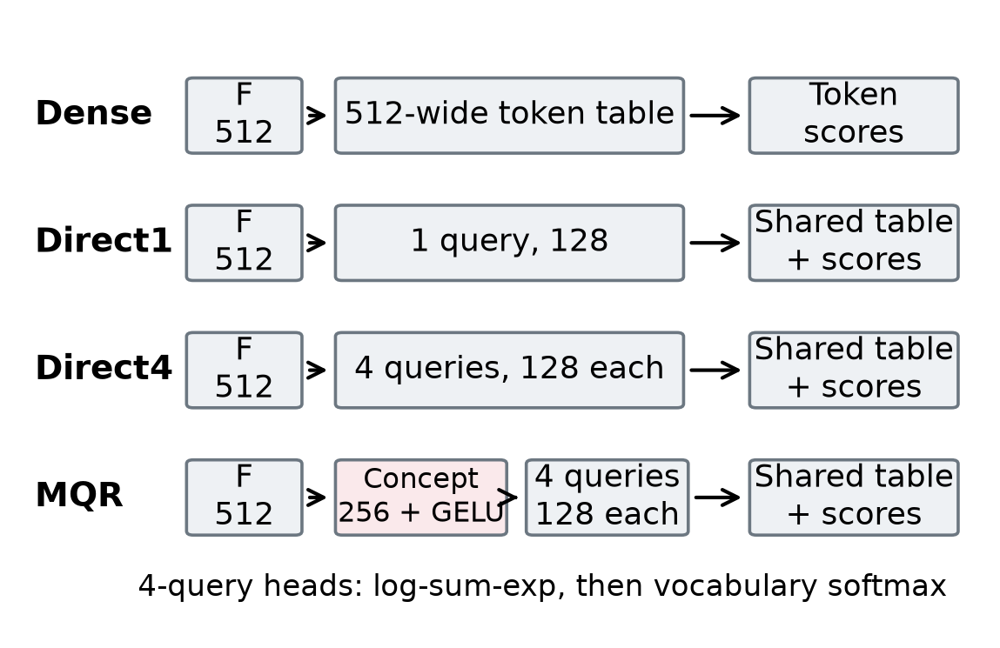
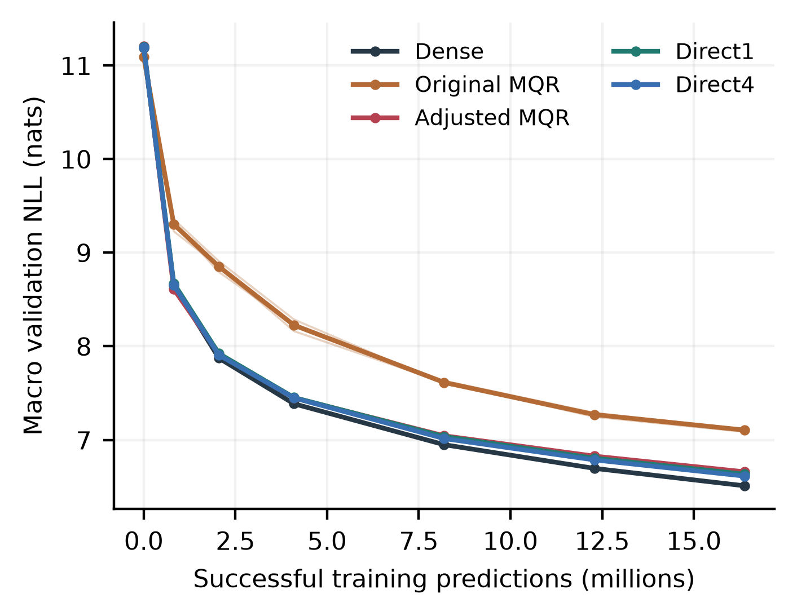
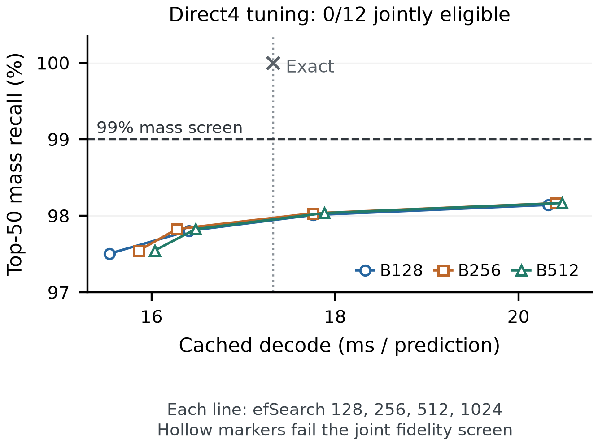

# MQR-LM

**A controlled study of multi-query vocabulary heads for language models.**

[](https://github.com/NaseriM1608/mqr-lm/actions/workflows/tests.yml)

MQR-LM is a research prototype that replaces a language model's conventional output head with a nonlinear concept representation, four compact query vectors, and a shared token table. This repository contains the implementation, matched controls, tests, paper draft, technical report, and compact numerical evidence from the completed investigation.

**The main result is negative for the tested MQR-v1 concept pathway.** Better initialization substantially improved MQR, but a simpler, almost parameter-matched Direct4 head achieved lower validation loss in every paired seed/language endpoint comparison. The subsequent CPU search study also failed to find an approximate serving configuration that met both fidelity requirements in its registered range.

The useful outcome is a documented experiment with strong controls, explicit probability calculations, retained measurements, and clearly bounded conclusions. This is a research draft, not a production model or a peer-reviewed publication.

**Start here:** [paper draft (PDF)](research/paper/paper.pdf) · [complete report (PDF)](research/report/report.pdf) · [numerical evidence](research/README.md) · [reproduction guide](docs/REPRODUCING.md)

## Contents

- [The hypothesis](#the-hypothesis)
- [Architecture and controls](#architecture-and-controls)
- [Training and data](#training-and-data)
- [Learning results](#learning-results)
- [What the initialization result means](#what-the-initialization-result-means)
- [CPU inference and retrieval](#cpu-inference-and-retrieval)
- [Search tuning and separate confirmation](#search-tuning-and-separate-confirmation)
- [Interpretation and limitations](#interpretation-and-limitations)
- [Installation and quick start](#installation-and-quick-start)
- [Repository structure and reproducibility](#repository-structure-and-reproducibility)

## The hypothesis

A conventional language model scores its next token against one output vector for every vocabulary entry. A narrower output table saves parameters and storage, but can reduce predictive capacity.

MQR-v1 tested whether four learned queries could recover useful representation and retrieval coverage, and whether an intermediate **concept map plus GELU** would improve on projecting the decoder state directly into those queries.

Those are separate questions. Comparing MQR only with a full dense head would confound the concept pathway with table width, parameter count, and scoring structure. Direct1 and Direct4 therefore serve as essential controls.

## Architecture and controls

All five learning arms share the same decoder geometry: 12 layers, model width 512, eight attention heads, FFN width 2,048, context length 512, and a vocabulary of 65,536 tokens. Input and output embeddings are untied.



| Head | How vocabulary queries are formed | Shared output table | Total parameters |
|---|---|---|---:|
| Dense | Use the 512-wide decoder feature directly | 65,536 × 512 | 104,913,920 |
| Direct1 | One affine projection: 512 → 128 | 65,536 × 128 | 79,813,760 |
| Direct4 | One affine projection: 512 → 512, reshaped into four 128-wide queries | 65,536 × 128 | 80,010,752 |
| MQR-v1 | 512 → 256 concept map + GELU, then four 128-wide queries | 65,536 × 128 | 80,011,008 |

**Four vocabulary queries do not mean four attention heads.** They are four scoring vectors in the output head. Direct4 differs from MQR by only **256 parameters**, making it a close control for the additional concept pathway.

For a final normalized decoder feature $F$, MQR computes:

$$
C=\mathrm{GELU}(F W_c+b_c), \qquad q_j=C V_j+b_j.
$$

Each query scores the same learned token vectors $E_v$. The component scores are aggregated before the vocabulary softmax:

$$
a_{jv}=q_j^\top E_v, \qquad z_v=\log\left(\sum_{j=1}^{M}\exp(a_{jv})\right)-\log M.
$$

$$
p(v\mid F)=\frac{\exp(z_v)}{\sum_u\exp(z_u)}.
$$

Here $M=4$ for MQR and Direct4. Direct1 uses one query. There is no learned branch gate, output-token bias, mandatory vector normalization, or changed temperature in the tested configuration. Subtracting $\log M$ cancels in the final softmax for fixed $M$.

Training uses **exact full-vocabulary cross-entropy**. Candidate retrieval is an inference approximation; it does not replace the training denominator. This global aggregation is not an independently gated mixture of separately normalized softmax distributions.

See [the architecture guide](docs/ARCHITECTURE.md) and [head implementation](src/mqr/heads.py).

## Training and data

The main learning comparison used five arms and three seeds, for **15 completed runs**. Within a seed, arms began with the same decoder weights and received the same successful training windows. Their decoder weights subsequently evolved separately.

| Item | Completed study |
|---|---|
| Languages | English, German, Arabic, Persian |
| Tokenizer | Shared 65,536-entry ByteLevel BPE, fitted on training text only |
| Selected development documents | 55,153 |
| Balanced available training positions | 26,199,704; 6,549,926 per language |
| Exposure per run | 1,000 successful updates × 16,384 predictions = 16.384 million predictions |
| Per-update language exposure | Exactly 4,096 predictions per language |
| Optimizer | AdamW; peak LR 3e-4; 50 warmup updates |
| Schedule | 4,000-update cosine horizon; **stopped at 1,000** |
| Precision and loss execution | FP16 with gradient scaling; exact CE in 512-position chunks |
| Validation | Fixed bank predicting 131,072 tokens per language; equal-language macro NLL |
| Test stream | Locked for model selection; no test benchmark result is claimed |

Available corpus positions and consumed training predictions are different quantities. Sampling windows need not be unique. The three-seed experiment consumed 245.76 million training predictions across its 15 runs, not a completed 3-billion-token training program.

English came from FineWeb, German and Arabic from FineWeb2, and Persian from mC4 plus native Wikipedia. This was a bounded, conditionally sampled development snapshot with documented filtering, splitting, decontamination, and Persian ZWNJ-preservation checks. It is not a representative sample of all four languages. Raw corpora, processed token streams, and model checkpoints are not distributed here.

See [data scope and availability](docs/DATA.md) and the [frozen learning protocol](research/protocols/learning.md).

## Learning results

**Lower negative log-likelihood (NLL) is better.** Values below are three-seed mean macro validation NLL, in nats, at the matched 1,000-update endpoint.

| Arm | Mean macro NLL | Gap to dense | Total parameters |
|---|---:|---:|---:|
| Dense | **6.509684** | Reference | 104,913,920 |
| Original MQR | 7.104622 | +0.594938 | 80,011,008 |
| Initialization-adjusted MQR | 6.659180 | +0.149495 | 80,011,008 |
| Direct1 | 6.633984 | +0.124300 | 79,813,760 |
| Direct4 | **6.613376** | +0.103692 | 80,010,752 |

Adjusted MQR lost to Direct4 in **all 12 paired seed/language endpoint cells**: three seeds × four languages. The mean paired macro MQR-minus-Direct4 difference was **+0.045804 nats**, with sample SD **0.007326** across the three seed differences. The language cells are not 12 independent training replications.

Direct4 also improved NLL over Direct1 by about **0.020608 nats**, while Direct1 used fewer parameters and lower measured exact CPU decode time. Dense retained the best learning likelihood. No one control was best on every metric.



An early lead did not persist: adjusted MQR led Direct4 at update 50, then trailed it at the later endpoints. All arms were still improving when training stopped. These results do not prove convergence or predict the result of an unexecuted continuation.

The [learning score export](research/results/learning/scores.csv) and [paired endpoint gaps](research/results/learning/paired_endpoint_gaps.csv) retain the underlying values.

## What the initialization result means

Original MQR started with much smaller centered logit variation than the dense head. A training-only feature calibration rescaled its existing final query-projection weights and bias before training to match dense's initial score variation. It added **no parameters and no inference operation**. Adjusted Direct controls received the corresponding initialization intervention as well.

The adjustment reduced MQR's mean NLL from 7.104622 to 6.659180. Relative to dense, the deficit fell from 0.594938 to 0.149495 nats:

$$
1-\frac{6.659180-6.509684}{7.104622-6.509684}\approx74.9\%.
$$

**This is 74.9% closure of the NLL deficit against dense, not a 74.9% improvement in accuracy or total NLL.** The reduction in MQR's total NLL was approximately 6.27%. Initialization materially improved the prototype, but did not remove the remaining deficit against dense or Direct4.

The branches also contributed distinct retrieval candidates. For adjusted MQR at B128, omitting a retrieval branch reduced top-50 mass recall by 14.70–26.82 percentage points despite reallocating the same total budget. Functional query diversity therefore coexisted with an unfavorable concept-path comparison; complete query collapse was not a sufficient explanation.

## CPU inference and retrieval

The first serving study, on **25 October 2026**, used the five retained seed-0, update-1,000 checkpoints on one shared Intel Xeon 2.20 GHz CPU host. Execution used FP32, two Torch/Faiss threads, and 32 complete validation documents giving 256 correlated prefix contexts.

Complete cached-decode timing includes 16 head predictions and 15 cached backbone steps. Each value is the mean of 16 request-cell medians, with three repeats per cell. Exact and ANN paths followed the same forced exact continuation **within each checkpoint**; trajectories could differ across models.

| Arm | Exact decode ms/pred. | HNSW B128 ms/pred. | HNSW greedy agreement | Top-50 mass recall |
|---|---:|---:|---:|---:|
| Dense | 21.485 | 15.453 | 90.625% | 80.578% |
| Original MQR | 18.297 | 16.281 | 97.266% | 93.018% |
| Adjusted MQR | 18.209 | 16.861 | 99.609% | 97.356% |
| Direct1 | **16.436** | 15.288 | 87.500% | 77.079% |
| Direct4 | 18.013 | 16.696 | 99.219% | 97.506% |

Exact adjusted MQR was 15.25% faster than exact dense on this workload. Direct1 and Direct4 had better learning NLL and lower observed exact time than MQR. These are descriptive one-host measurements, not GPU results or statistically established latency rankings.

The compact heads use a **32 MiB FP32 output table**, compared with dense's **128 MiB**. This is output-table storage, not total process memory. Serial execution in a shared process prevents interpreting retained allocator memory as an isolated per-model RSS comparison.

### Why high greedy agreement was insufficient

The registered point screen required both:

1. At least **99.5% own-head greedy agreement**.
2. At least **99% exact-top-50 probability-mass recall**, denoted $R_{50}$.

For candidate set $S$ and the exact model's top-50 set $T$:

$$
R_{50}=\frac{\sum_{v\in S\cap T}p(v)}{\sum_{v\in T}p(v)}.
$$

This differs from **total retained probability**, $\sum_{v\in S}p(v)$, which uses the entire vocabulary distribution. Recovering the most likely token does not establish faithful sampling from the full distribution. Normalizing only the surviving candidates produces a truncated distribution, not exact language-model likelihood.

All **15** HNSW arm/budget combinations in the first study failed the joint screen. Adjusted MQR at B128 passed greedy agreement but recalled only 97.356% of top-50 mass and retained 53.039% of total probability. Its exhaustive per-query union recalled 99.997% of top-50 mass, showing additional approximate-index error in that cell. Exhaustive per-query union itself is not guaranteed to recover the globally aggregated winner for every head or budget.

See the [CPU protocol](research/protocols/cpu.json), [full coverage export](research/results/cpu/fidelity.csv), and [raw timing export](research/results/cpu/raw_timings.csv).

## Search tuning and separate confirmation

The **27–28 October follow-up** asked whether ordinary candidate-budget and HNSW search-effort tuning could recover a useful serving point. It included **dense, Direct1 and Direct4**, with no MQR arm, no new training, and no activation change.

- Candidate budgets: **128, 256, 512**.
- `efSearch`: **128, 256, 512, 1024**.
- Graph connectivity: 32; `efConstruction`: 200; one fixed graph per arm.
- Tuning: the previous 32 serving documents.
- Confirmation: 32 additional documents, disjoint by persistent ID and content hash, from the same development validation distribution.
- Selection: tuning data only; the choice was committed before confirmation features or metrics were evaluated.

**Zero of the 36 tuning configurations met both fidelity thresholds.** The selected settings were therefore diagnostic fallbacks, not eligible winners. Passing confirmation alone could not retrospectively promote an ineligible fallback.

| Arm | Diagnostic B / efSearch | Confirmation greedy | Confirmation $R_{50}$ | Total probability retained | Fresh exact ms/pred. | ANN ms/pred. |
|---|---|---:|---:|---:|---:|---:|
| Dense | 128 / 1024 | 87.500% | 80.621% | 44.749% | 20.203 | 15.954 |
| Direct1 | 256 / 1024 | 87.109% | 75.052% | 44.375% | 15.545 | 15.995 |
| Direct4 | 512 / 1024 | **100.000%** | **98.287%** | **66.063%** | **17.231** | **20.339** |

Direct4's ANN fallback was **18.04% slower** than its own freshly measured exact path and still missed the 99% mass-recall requirement. Dense was faster under ANN but failed fidelity substantially; Direct1 was 2.90% slower and also failed. Do not compare these new timings against the older 25 October baselines as though they were one paired timing run.

At the same B512 budget, exhaustive per-query union retrieval for Direct4 confirmation achieved **100% top-50 mass recall** but only **67.862% total retained probability**. This separates additional ANN error from the substantial distribution truncation that remains even with exhaustive per-query retrieval.



The narrow conclusion is that ordinary budget/`efSearch` tuning did not solve this fixed-graph CPU serving problem in the registered range. It is not a result about all HNSW constructions or all approximate vocabulary-search methods. [Protocol](research/protocols/search.json) · [all configurations](research/results/search/coverage.csv) · [timings](research/results/search/timings.csv)

## Interpretation and limitations

The completed evidence supports closing **this tested MQR-v1 concept-path investigation** as a scale-up candidate. It does not require claiming that every conceivable modification must fail.

- Only three training seeds were evaluated, at 1,000 updates of a 4,000-update schedule. Convergence is unestablished.
- The concept-path ablation changes depth, bottleneck geometry, nonlinearity, and optimization properties together. It does not isolate a universal effect of GELU. No alternate-activation experiment was performed.
- The dataset and tokenizer define a bounded four-language development setting. Decontamination and quality checks have a recorded, incomplete scope.
- Serving used one trained seed, one shared CPU host, correlated prefixes, finite timing repeats, and one graph per arm in the follow-up. The fidelity screens are point summaries, not population confidence bounds.
- No quantized-dense baseline, GPU-serving comparison, full training continuation, downstream task evaluation, translation result, or human-rated generation benchmark is claimed.
- Automated audits and separately executed AI-agent reviews are not independent human peer review.

One retrospective numerical-checker correction is disclosed: the initial CPU audit's branch-marginal sanity tolerance changed from 1e-6 to 1e-4 after observed FP32 reduction drift. This affected those sanity checks only. It did not change raw measurements, model scoring, candidate sets, fidelity thresholds, or the frozen experimental code, and did not require rerunning the experiment. The [correction record](research/results/cpu/checker_correction.md) and original audit identities remain preserved.

## Installation and quick start

Use **Python 3.11 or newer**. A CPU installation is sufficient for the tests and small examples.

```bash
git clone https://github.com/NaseriM1608/mqr-lm.git
cd mqr-lm
python -m venv .venv
```

Activate it using `source .venv/bin/activate` on Linux/macOS, or `.venv\Scripts\Activate.ps1` in PowerShell. Then:

```bash
python -m pip install --upgrade pip
python -m pip install "torch>=2.5,<3" --index-url https://download.pytorch.org/whl/cpu
python -m pip install -e ".[dev,corpus,ann]"
python -m pytest -q
```

The lighter `python -m pip install -e ".[dev]"` installs the core implementation and test runner. Tokenizer/data/Faiss tests need the corresponding optional dependencies and may skip without them. Historical numerical gates that require the private frozen readiness archive skip explicitly when it is unavailable; they are not represented as reproduced scientific measurements.

During publication preparation on 1 November 2026, the local CPU suite completed with **351 passed and 5 explicitly skipped private-input gates**. The two-step smoke train/evaluate/generate path, paper renderer, and exported-result summary also ran successfully. These are software and publication checks, not additional scientific replications.

### Inspect a configuration

```bash
python -m mqr inspect --config configs/runs/smoke_mqr.json
```

### Run a tiny implementation smoke test

```bash
python -m mqr train --config configs/runs/smoke_mqr.json --train-text examples/smoke_train.txt --validation-text examples/smoke_validation.txt --run-dir .local/smoke-mqr --stop-after 2
python -m mqr generate --checkpoint .local/smoke-mqr/last.pt --prompt "The next token is" --max-new-tokens 16
```

This is a byte-tokenized, tiny model trained on toy text. Its output is an implementation demonstration, **not a reproduction of the research results**. The `smoke_dense`, `smoke_direct1` and `smoke_direct4` configurations provide the corresponding controls. [More commands and reproduction boundaries](docs/REPRODUCING.md).

### Verify the published result exports

```bash
python research/summarize.py
```

This standard-library script verifies the publication manifest and recomputes the principal aggregates from the included exports. It does not load model weights, access the internet, retrain a model, or rerun inference. Exact full-model reproduction requires the original data preparation records, tokenizer, private checkpoints, and authorized data access.

## Repository structure and reproducibility

```text
src/mqr/                 Model, heads, exact loss, retrieval, training and data tools
tests/                   Implementation and provenance tests
configs/                 Runnable smoke/pilot configurations and historical study specs
examples/                Small text fixtures for offline smoke tests
notebooks/               Historical bounded Kaggle notebooks; no saved outputs
docs/                    Architecture, data and reproduction guides
research/paper/          Current paper draft, editable source, assets and PDF renderer
research/report/         Complete technical report and its figures
research/results/        Compact numerical exports and audit records
research/protocols/      Frozen learning, CPU and search-study protocols
research/methods/        Preserved numerical-gate helper
research/provenance.json Source and publication identities
```

The public repository deliberately excludes raw datasets, token streams, checkpoints, private execution packages, credential files, generated preview images, local environments, and the brag video. Original large experiment records are retained outside the published tree. The included [evidence guide](research/README.md) distinguishes aggregate reanalysis from a new checkpoint audit.

The research hypothesis and direction were supplied by the researcher. AI tools assisted with implementation, orchestration, analysis, checks, and manuscript preparation. The paper discloses that assistance. The draft has not been submitted or published, and its final author list and affiliations remain to be supplied and verified by the researcher.

No project license has been selected. Dataset and third-party resource permissions are separate from this repository. See [citation guidance](CITATION.md).
