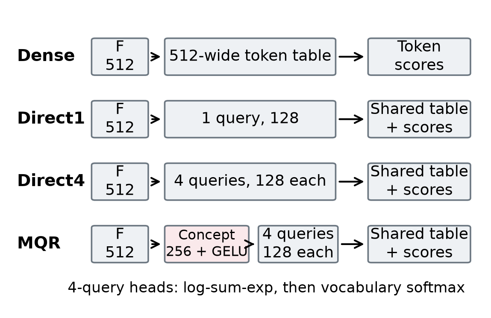
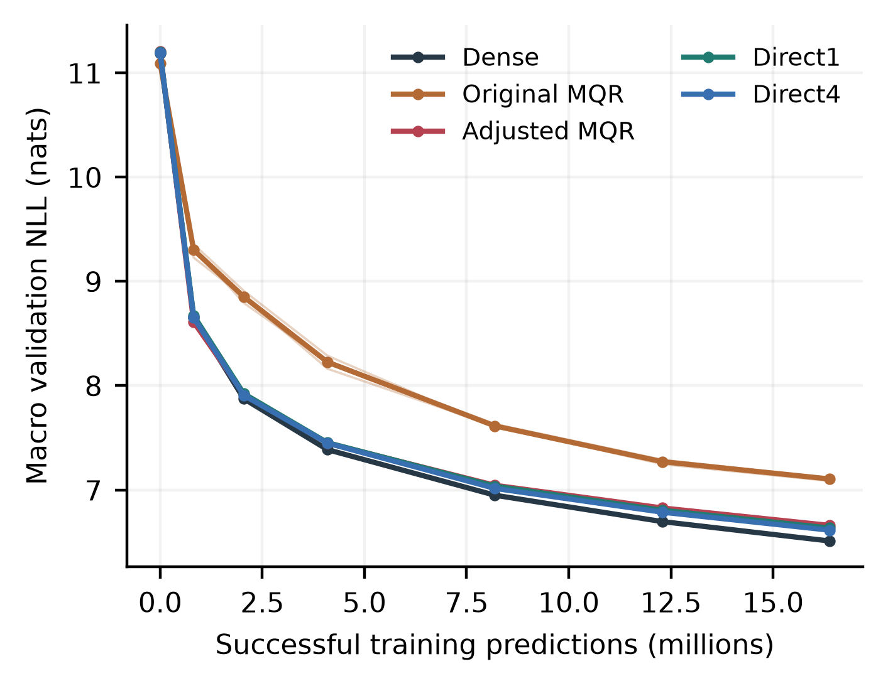
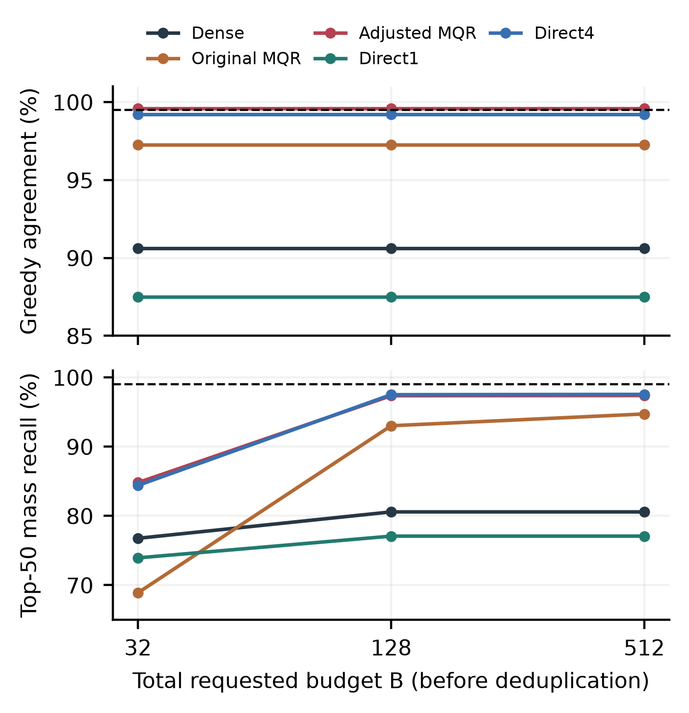

# Query Diversity Without a Likelihood Advantage: A Controlled Study of Multi-Query Vocabulary Heads

Author: Mahmoud Naseri

Research manuscript draft | Originally 25 October 2026; revised 28 October 2026

## Abstract

Compact vocabulary representations can reduce output-table storage, but their benefits require comparison with simple factorized heads. We investigate MQR-v1, a nonlinear concept pathway producing four parallel 128-dimensional vocabulary queries against a shared token table, with global log-sum-exp aggregation and exact full-vocabulary training. A five-arm study compares dense, direct one-query and four-query controls, and original and initialization-adjusted MQR in a four-language, 65,536-token prototype. Across three seeds and 16.384 million training predictions per run, initialization adjustment reduces MQR's mean validation-NLL deficit against dense from 0.595 to 0.149 nats. Adjusted MQR nevertheless trails nearly parameter-matched Direct4 in all 12 paired seed/language endpoint cells, despite distinct branch retrieval contributions. Exact adjusted MQR reduces observed CPU decode latency by 15.25% relative to dense, while direct heads provide better likelihood and lower observed latency. The first HNSW diagnostic passes no joint fidelity screen. A separate three-arm search follow-up finds no eligible setting among 36 tuning configurations. On disjoint confirmation documents, Direct4's diagnostic fallback reaches 100% greedy agreement but 98.287% top-50 mass recall, below the required 99%, while taking 18.04% longer than exact Direct4. These bounded results support closing the tested concept-path investigation and evaluating approximate decoding with distribution coverage as well as greedy agreement.

## 1 Introduction

A language model's vocabulary projection can account for substantial parameter storage and inference work. A conventional output head compares the decoder state with one vector per vocabulary token. Reducing the width of these output vectors offers a direct compression mechanism, while also restricting the representation available for next-token prediction. Multiple low-dimensional queries are a plausible way to recover expressive or retrieval coverage: each query can score a different region of the same token table, and their scores can be combined before vocabulary normalization.

This hypothesis has two distinct parts. Multiple queries might improve upon a single compact query, and an intermediate nonlinear concept representation might improve upon directly projecting the decoder state into multiple queries. The second claim requires a strong control. A comparison with dense alone confounds the proposed concept mechanism with changes in output-table width, parameter count, and scoring structure. We therefore include Direct4, which directly produces four 128-dimensional queries and differs from MQR by only 256 parameters. It shares MQR's output-table size, query count, and aggregation law. Direct1 provides a simpler factorized one-query alternative.

We study these heads in a controlled four-language prototype and separate exact language modeling from approximate inference. All learning runs optimize full-vocabulary cross-entropy. Approximate search is introduced only for inference, where a union of per-query candidates is reranked under the unchanged full-query score. This distinction permits independent evaluation of learning quality, query contributions, and search omissions.

The central finding is negative for the tested concept pathway. Initialization calibration substantially improves MQR, but adjusted MQR remains worse than dense and Direct4 at the fixed learning endpoint. Its four branches nevertheless contribute distinct retrieved probability mass. Exact compact heads also reduce observed CPU latency relative to dense, although Direct controls provide the stronger measured tradeoffs. After the first fixed-search diagnostic, we separately tune candidate budget and HNSW search effort for dense and the Direct controls. Neither study produces an eligible approximate serving point, even when observed greedy agreement is perfect.

Our completed evidence contributes: (i) a three-seed concept-path comparison with a nearly parameter-matched direct control; (ii) an initialization-scale diagnosis and a parameter-free adjustment that materially improves early learning without rescuing endpoint competitiveness; (iii) evidence of functional retrieval diversity despite the likelihood deficit; and (iv) real-checkpoint CPU comparisons separating exact decode cost from ANN distributional fidelity, including a prospectively separated tuning/confirmation follow-up. These contributions concern a bounded empirical investigation, rather than a superior language-model architecture or a general impossibility result.

## 2 Related Work

Continuous-output sequence models establish precedent for predicting through continuous representations rather than a conventional vocabulary classifier. Kumar and Tsvetkov [1] investigate a von Mises-Fisher objective for sequence-to-sequence models. MQR instead retains exact categorical likelihood over a learned output table. Our study does not establish that continuous outputs or lower-dimensional token representations are new.

Yang et al. [2] analyze the softmax bottleneck and introduce mixture-of-softmax parameterizations. This work motivates considering richer output distributions, but MQR's implementation aggregates unnormalized component scores before one vocabulary softmax. It has no independently parameterized mixture gate. Its effective branch weights arise from component partition functions, as Section 3 explains. We do not include a true mixture-of-softmax baseline and make no claim of improving on that family.

Large-output-space prediction and approximate vocabulary search also predate this project. Vijayanarasimhan et al. [3] study prediction with large output spaces, while Loretz and Hochreiter [4] investigate vector-index output embeddings for CPU language-model inference. These precedents motivate including dense-plus-ANN alongside the compact heads; retrieval over output embeddings is not our novelty claim. Chen et al. [5] use multiple autoregressively generated queries for document retrieval with multiple relevant targets. Our parallel queries are trained by next-token likelihood, without that work's assignment procedure or retrieval objective.

Finally, observed inference cost depends on memory traffic and execution geometry as well as arithmetic. The Roofline perspective [6] provides relevant systems context, while nearest-neighbor benchmarking work [7] emphasizes the role of data and query geometry. We use these perspectives to delimit interpretation: equal leading multiply-accumulate counts do not prove equal latency, and one fixed index configuration cannot characterize all ANN vocabulary search.

## 3 Multi-Query Vocabulary Heads

### 3.1 Shared scoring contract

Let the final normalized decoder feature be a row vector F of width 512. For MQR, the concept representation C has width 256 and each query has width 128. With learned affine projections,

$$ C=\mathrm{GELU}(F W_c+b_c). $$

$$ q_j=C V_j+b_j,\qquad j=1,\ldots,M. $$

Every query uses the same learned token table E. Writing the query and token vectors as coordinate vectors for the inner product,

$$ a_{jv}=q_j^\top E_v. $$

$$ z_v=\log\left(\sum_{j=1}^{M}\exp(a_{jv})\right)-\log M. $$

$$ p(v\mid F)=\frac{\exp(z_v)}{\sum_u\exp(z_u)}. $$

The tested multi-query heads use M=4. There is no learned branch gate, output-token bias, compulsory vector normalization, or changed temperature. Subtracting log M is constant across tokens and cancels in the vocabulary softmax. Query count refers to vocabulary-scoring vectors, independently of the decoder's attention heads.

For clarity, if Z_j is the sum of exp(a_jv) over vocabulary tokens, then the same distribution has the decomposition

$$ p(v\mid F)=\sum_j\frac{Z_j}{\sum_k Z_k}\,\frac{\exp(a_{jv})}{Z_j}. $$

Thus equal coefficients in the log-sum-exp do not enforce equal effective branch weights. These weights depend on component partition functions; the implementation does not average separately normalized softmaxes with fixed equal weights.

### 3.2 Controls and training objective

Dense scores tokens directly against a 512-wide output table. Direct1 forms one affine 128-wide query from F. Direct4 forms four affine 128-wide queries directly from F and uses the same shared table and aggregation as MQR. Only MQR inserts the 256-wide GELU concept pathway. Table 1 gives sizes; original and adjusted MQR have identical architectures.

$$ z_v^{\mathrm{dense}}=\sum_{r=1}^{512}F_r E_{vr}^{\mathrm{dense}}. $$

$$ q_j^{\mathrm{direct}}=F D_j+b_{D,j},\qquad M\in\{1,4\}. $$

| Head | Queries | Concept width | Head parameters | Total parameters |
|---|---:|---:|---:|---:|
| Dense | 1 x 512 | -- | 33,554,432 | 104,913,920 |
| Direct1 | 1 x 128 | -- | 8,454,272 | 79,813,760 |
| Direct4 | 4 x 128 | -- | 8,651,264 | 80,010,752 |
| MQR | 4 x 128 | 256 | 8,651,520 | 80,011,008 |

Table 1. Architecture sizes. Input and output embeddings are untied. Direct4 is a near parameter match for the concept pathway, not a dense-capacity match.

Training minimizes exact full-vocabulary negative log-likelihood, averaged over valid next-token positions:

$$ \mathcal{L}=-\frac{1}{N}\sum_{t=1}^{N}\log p(y_t\mid F_t). $$

Position chunking reduces materialized activations without replacing the vocabulary denominator. Direct1 is an affine factorized readout. Direct4's log-sum-exp is nonlinear; multiplying its query count by width does not establish equivalence to a rank-512 linear classifier.

### 3.3 Initialization and retrieval

The initialization-adjusted arms multiply only their existing final query-projection weights and bias by a scalar fitted before training. For each seed, a frozen training-only feature bank supplies logits. We center each context's logits across vocabulary tokens and match their root-mean-square variation to that seed's dense head using bisection. This adds no learned scalar, parameter, or inference operation. Because rescaling also changes branch responsibilities and relative parameter updates, it is not a causal isolation of gradient magnitude.

At inference, each query requests k neighbors; their IDs are unioned and deduplicated, with normally scored EOS always included. All candidates are then reranked using all original queries. Gold tokens are never injected. Normalization over candidates alone produces a truncated distribution and cannot replace exact language-model NLL.

Even exhaustive per-query retrieval can omit the aggregate winner. For example, component score pairs (10,-100), (-100,10), and (9.5,9.5) select the first two tokens as per-query top-1, although the third has the largest aggregated score. We therefore measure exhaustive-union coverage separately from additional ANN error.

## 4 Experimental Setup

### 4.1 Learning experiment

The shared decoder has 12 layers, width 512, eight attention heads, FFN width 2048, context length 512, zero dropout, RoPE, and untied input/output embeddings. Within a seed, all arms begin with identical decoder weights and receive identical successful training windows. Their decoder weights subsequently evolve separately. The five arms are dense, original MQR, adjusted MQR, adjusted Direct1, and adjusted Direct4. We use seeds 0, 1, and 2; subsequent references to Direct1/4 denote their adjusted versions.

The bounded development snapshot contains 55,153 selected documents from English FineWeb, German and Arabic FineWeb2, and Persian mC4 plus native Wikipedia. A 65,536-entry ByteLevel BPE is fitted on training text only. Identity-group splitting, duplicate and benchmark screening, and common quality filters precede the final balanced streams. There are 6,549,926 usable training positions per language, or 26,199,704 in total. The validation and locked test streams contain 3,103,636 and 3,256,212 positions respectively. Sampling restrictions, residual noise, and decontamination limits preclude treating this corpus as representative of all four languages.

Each run completes 1,000 successful updates of 16,384 predictions, with exactly 4,096 predictions per language per update. This yields 16.384 million predictions per run and 245.76 million across 15 runs; sampled windows need not be unique. Training uses FP16 with gradient scaling, microbatch eight and accumulation four, AdamW with betas (0.9,0.95), weight decay 0.1, gradient clipping 1.0, and reference exact cross-entropy in chunks of 512 positions. Peak learning rate is 3e-4 after 50 warmup updates, followed by a cosine schedule with a 4,000-update horizon and floor ratio 0.1. Runs stop at 1,000 without completing the schedule.

Validation occurs at updates 0, 50, 125, 250, 500, 750, and 1,000. A fixed bank contains 256 disjoint 513-token blocks per language, predicting 131,072 tokens per language. We report equal-language macro NLL and paired differences across model seeds. Languages are not additional independent training replications. The test stream remains locked. The completed audit records all 15 endpoints, paired successful batch streams, remote checkpoint reloads, and zero AMP overflows.

### 4.2 Initial CPU inference and fidelity

The 25 October serving study uses the five seed-0 update-1,000 checkpoints serially on one Intel Xeon 2.20 GHz host with four logical CPUs and approximately 33.66 GB RAM. Execution uses FP32, two Torch/Faiss threads, Torch 2.11.0+cpu, and Faiss 1.15.1. A separate validation workload selects eight complete documents per language, each with at least 257 text tokens. Eight early-document prefixes per document produce 256 teacher-forced coverage contexts at lengths 32 through 256. These correlated contexts are distinct from the learning validation bank.

Coverage compares exhaustive per-query retrieval, exact Faiss search, and HNSW. Total requested budgets B are 32, 128, and 512, divided evenly among queries before deduplication; EOS can add one candidate. HNSW uses graph connectivity 32, efConstruction 200, and efSearch 128 throughout. These are fixed settings rather than a tuned quality-latency frontier.

For exact distribution p, candidate union S, and exact top-50 set T, probability-mass recall is

$$ R_{50}=\frac{\sum_{v\in S\cap T}p(v)}{\sum_{v\in T}p(v)}. $$

The registered point screens require at least 99.5% own-head greedy agreement and 99% R_50. We also retain full probability mass on S, gold inclusion, and per-language results. Metrics average context-level quantities within language, then equally across languages; they are not population lower confidence bounds.

Timing is measured only at B128 and for exact scoring. Sixteen batch-one request cells per model/method use two documents per language and prefixes 32/128. Each predicts 16 tokens, with one warmup and three repeats; exact/HNSW order alternates. Both methods within a checkpoint follow its same forced exact continuation, although continuations differ across checkpoints. Primary cached decode includes 16 head predictions and 15 cached backbone steps. We report means of request-cell medians, separately from prefill, combined requests, and instrumented stage timings. No tail-latency inference is made.

### 4.3 Separate search tuning and confirmation

The follow-up retains the dense, Direct1 and Direct4 seed-0 checkpoints and their exact scoring laws. It crosses B128/256/512 with efSearch 128/256/512/1024, giving 12 configurations per arm. Graph connectivity 32 and efConstruction 200 remain fixed, with one graph per arm reused throughout. No MQR arm, training, activation change, quantization or GPU inference is included.

The previous 32 serving documents supply tuning coverage. Confirmation uses 32 additional complete validation documents, excluded by persistent ID and content hash from tuning and frozen before new measurements. Each phase has eight documents per language and 256 contexts. This is additional development validation, rather than a locked test or a new training seed. Selection uses tuning coverage and complete cached-decode time only. The fastest configuration passing both fidelity screens is eligible; if none passes, a predeclared deterministic fallback rule selects a diagnostic setting. Each choice is committed before confirmation features or metrics are evaluated; confirmation cannot promote an ineligible fallback.

Timing uses eight tuning and 16 confirmation request cells, with prefixes 32/128, one warmup and three repeats. The same matched forced-continuation design is used within each checkpoint. Exact baselines are freshly measured in the new run. The run uses FP32 and two Torch/Faiss threads on one shared CPU host; its full notebook wall time is 833.46 seconds. No additional learning NLL is measured.

## 5 Results

### 5.1 RQ1-RQ2: likelihood and the concept pathway

Dense has the lowest endpoint validation NLL. Adjusted MQR improves substantially over original MQR, but retains a 0.149495-nat mean deficit against dense (Table 2). Against Direct4, adjusted MQR is worse in all 12 paired seed/language endpoint cells. The mean paired macro difference is +0.045804 nats, with sample SD 0.007326 and SE 0.004230 across three seeds. This descriptive consistency supports a negative endpoint conclusion for the tested concept pathway without treating language cells as independent replications.

| Arm | Mean macro NLL | Gap vs dense | Paired gap SD |
|---|---:|---:|---:|
| Dense | 6.509684 | -- | -- |
| Original MQR | 7.104622 | +0.594938 | 0.022096 |
| Adjusted MQR | 6.659180 | +0.149495 | 0.004614 |
| Direct1 | 6.633984 | +0.124300 | 0.014704 |
| Direct4 | 6.613376 | +0.103692 | 0.008338 |

Table 2. Three-seed endpoint learning comparison after 16.384 million predictions per run. Lower NLL is better. SD describes paired seed differences against dense; it is not a confidence interval. Exact CPU latency uses only seed 0.

Figure 2 shows that the final ranking cannot be inferred from the earliest checkpoints. Adjusted MQR leads Direct4 at update 50; its mean deficit is 0.000394 at update 250, 0.029951 at 500, 0.040410 at 750, and 0.045804 at 1,000. Its gap against dense also increases over these later checkpoints. All arms continue improving, so these results establish neither convergence nor the outcome of an unexecuted continuation.

Direct4 improves mean NLL over Direct1 by 0.020608 nats, while Direct1 uses fewer parameters and lower observed serving time. Thus no single direct control is best on every metric. Nevertheless, MQR's concept pathway does not justify its added structure relative to Direct4 in this comparison. The ablation jointly changes depth, bottleneck geometry, nonlinearity, and optimization properties; it does not identify GELU itself as the cause.

### 5.2 Initialization materially changes learning

A diagnostic on real training features found centered initial logit SDs of 0.453748 for dense, 0.095311 for Direct1, 0.046950 for Direct4, and 0.008977 for original MQR. The unusually small MQR variation motivated the training-only scale adjustment. In the completed three-seed confirmation, adjusted MQR lowers mean NLL from 7.104622 to 6.659180, reducing its deficit against dense by approximately 74.9%.

This is a substantive optimization finding: an otherwise identical architecture learns much better after changing its initialization. It also limits what can be concluded from unadjusted baselines. However, the adjustment does not remove the longer-endpoint deficit against dense or Direct4. The earlier two-seed, 128-update readiness pilot closed 95-98% of the original dense gap under a different corpus, schedule, and validation bank; that result did not predict endpoint parity in the confirmation. We keep the two studies separate.

### 5.3 RQ3: functional query diversity

Adjusted MQR's queries do not simply become identical. At HNSW B128, mean query-pair cosine is 0.049, normalized marginal branch entropy is 0.943, and normalized expected token-responsibility entropy is 0.180. High marginal entropy together with low token-level responsibility entropy indicates that branches collectively carry substantial mass while individual tokens can be attributed unevenly across them.

The stronger evidence is functional. Each branch contributes candidates carrying probability mass unavailable from the other branches (Table 3). Removing one retrieval branch reduces coverage even after redistributing the same total budget among the remaining queries. The reference model and all-query reranking remain unchanged, so this measures retrieval contribution rather than a new three-query language model.

| Adjusted-MQR diagnostic, B128 | Recorded value |
|---|---:|
| Mean query-pair cosine | 0.049 |
| Normalized marginal branch entropy | 0.943 |
| Normalized token-responsibility entropy | 0.180 |
| Branch-unique full probability mass | 15.26 / 14.43 / 8.59 / 13.46% |
| Top-50 mass-recall drop on omission | 14.70-26.82 percentage points |
| Greedy-agreement drop on omission | 12.50-33.59 percentage points |

Table 3. Functional diversity on the seed-0 coverage bank. Unique mass excludes common EOS; each omission reallocates the fixed total search budget. Values are descriptive means or ranges over the four branch omissions, as appropriate.

Direct4 also exhibits material branch contributions. These measurements support functional retrieval diversity, without demonstrating semantic specialization. They show that diversity alone is insufficient to improve the measured learning/serving tradeoff.

### 5.4 RQ4: exact CPU inference

Exact adjusted MQR measures 18.209 ms per prediction versus dense's 21.485 ms, a 15.25% observed latency reduction. Direct1 measures 16.436 ms and Direct4 18.013 ms; original MQR measures 18.297 ms. Direct1 also has better learning NLL than adjusted MQR, while Direct4 combines better NLL with a similar parameter count and slightly lower observed latency. Small timing differences on this shared host are not asserted statistically significant.

The dense output table occupies 128 MiB in FP32, compared with 32 MiB for the compact heads. Dense and four-query heads have equal dominant score MACs in this geometry: 512 x V versus 4 x 128 x V. Their latency difference is consistent with execution geometry and data movement mattering, but the experiment does not isolate bandwidth as the cause. The observed advantage supports compact output representations in this setup; it does not establish a benefit of the concept mechanism.

Training cost provides a further caution. An earlier chunk64 execution used less allocated memory for MQR, but a common chunk512 comparison measured 4.5637 GiB for MQR against 3.1975 GiB for dense. Dense throughput also improved much more from chunking. Parameter count and one execution configuration therefore do not establish a persistent training-memory advantage. The learning comparison retained the common reference loss path rather than selectively promoting an alternative backend.

### 5.5 RQ5: ANN fidelity

No HNSW arm/budget combination passes both registered screens: zero of 15 cells, including B512 (Figure 4). At B128, adjusted MQR achieves 99.609% greedy agreement but only 97.356% top-50 mass recall. It retains 53.039% of the full distribution's total probability. Thus a high rate of preserving the top prediction can coexist with substantial distributional omissions.

| Arm, HNSW B128 | Greedy agreement | Top-50 mass recall | Total mass retained |
|---|---:|---:|---:|
| Dense | 90.625% | 80.578% | 43.910% |
| Original MQR | 97.266% | 93.018% | 41.736% |
| Adjusted MQR | 99.609% | 97.356% | 53.039% |
| Direct1 | 87.500% | 77.079% | 42.053% |
| Direct4 | 99.219% | 97.506% | 51.364% |

Table 4. Macro context-level fidelity against each checkpoint's own exact distribution. The joint screen requires greedy agreement >=99.5% and top-50 mass recall >=99%. Total retained mass has a different denominator from top-50 mass recall.

Exhaustive B128 union retrieval achieves 99.997% top-50 mass recall for adjusted MQR, compared with HNSW's 97.356%, separating additional ANN error from near-negligible exact-union omissions in that cell. Original MQR's exhaustive union reaches only 97.596%, so its errors cannot all be attributed to the index. Dense-plus-HNSW is also evaluated and fails; ANN is not restricted to the proposed architecture.

HNSW decreases measured decode time for all five checkpoints at B128, but these paths are ineligible under the joint fidelity criterion. Faster approximate decoding is not evidence of a matched-fidelity improvement. Four own-feedback prompts per model provide a separate integration diagnostic, not a substitute for coverage or a generation-quality benchmark.

### 5.6 Search effort does not recover an eligible serving point

None of the 36 tuning configurations satisfies both fidelity thresholds. All selected settings therefore remain diagnostic fallbacks. Direct4's B512/efSearch1024 choice reaches 99.609% greedy agreement but 98.168% R_50 on tuning. Additional search effort improves coverage while increasing cost (Figure 5); Appendix E retains every tuning configuration.

| Arm | Greedy | R_50 | Exact ms | ANN ms |
|---|---:|---:|---:|---:|
| Dense | 87.500% | 80.621% | 20.203 | 15.954 |
| Direct1 | 87.109% | 75.052% | 15.545 | 15.995 |
| Direct4 | 100.000% | 98.287% | 17.231 | 20.339 |

Table 5. Separate confirmation. Decode time is ms per prediction. Diagnostic choices are B128/efSearch1024 for dense, B256/efSearch1024 for Direct1, and B512/efSearch1024 for Direct4. Every ANN path is fidelity-ineligible.

Direct4's confirmation result is 18.04% slower than its freshly measured exact path while still missing the 99% R_50 requirement. Dense is 21.03% faster but fails fidelity substantially; Direct1 is 2.90% slower and also fails. The earlier learning NLLs remain unchanged. These observations establish no matched-fidelity speed advantage in the tested range.

At B512 on confirmation, exhaustive per-query union retrieval reaches 100% R_50 but retains only 67.862% of total model probability. The ANN choice reaches 98.287% R_50 and retains 66.063%. Additional approximate-index error and full-distribution truncation both remain. Perfect observed greedy agreement on these contexts therefore does not preserve the original sampling distribution. The conclusion concerns this graph construction, finite grid and retained checkpoints.

## 6 Discussion

The experiments distinguish three properties often conflated in an efficient-head proposal: learning a useful probability distribution, developing multiple retrieval directions, and reducing serving cost. MQR demonstrates the second property and an exact CPU benefit relative to dense, yet fails the primary concept-path comparison. This combination is informative because it rules out complete query collapse as a sufficient explanation of the negative endpoint result.

Direct4 is central to that interpretation. Dense comparisons alone could credit the concept mechanism for an advantage arising from a smaller output table. Direct4 preserves the compact table, four queries, and global aggregation while removing the intermediate concept pathway at nearly the same parameter count. Its better NLL shows that the added pathway is unnecessary for the measured quality level. The results do not determine whether the deficit comes from optimization, restricted representations, or their interaction; attributing it solely to GELU would exceed the ablation.

Initialization and execution also change the interpretation of preliminary evidence. An unadjusted MQR baseline understates the architecture's learning potential, while an early adjusted pilot overstates how close it remains to dense later. Similarly, fewer parameters do not guarantee lower training activation memory, and equal score arithmetic does not guarantee equal CPU latency. These observations favor matched controls and explicit workload accounting over architectural proxies for efficiency.

Finally, greedy agreement tests one decision rather than preservation of the model distribution. The adjusted-MQR B128 result passes the aggregate greedy screen while missing the top-50 mass screen; the Direct4 follow-up reaches perfect observed greedy agreement on confirmation while still missing R_50. Candidate normalization can conceal omissions by redistributing surviving probability to one. Approximate vocabulary evaluation should therefore report exact-reference mass coverage alongside token agreement and separate exhaustive-union error from ANN error. The negative sweep closes ordinary fixed-graph tuning in the registered range. It does not supply a new MQR learning comparison or isolate the effect of an alternate activation.

## 7 Limitations

The learning study has three model seeds and only 1,000 updates of a 4,000-update schedule. Its conclusion concerns the matched endpoint and does not establish convergence or the effect of longer training. The bounded, conditionally sampled corpus contains residual domain noise and language mixing; filtering and benchmark screening have incomplete coverage. Four languages and one shared tokenizer do not establish broad multilingual generality, and absolute cross-language token NLL cannot rank fluency. Learning blocks and inference prefixes are correlated rather than independent documents or independent model replications.

Each CPU study uses one trained seed and one shared host, with serial model execution and three repeats per timed cell. The first uses 32 validation documents and fixed search effort; the follow-up reuses these for tuning and adds 32 disjoint confirmation documents from the same development distribution. One graph per arm and a finite budget/efSearch grid do not establish an optimized or graph-robust ANN frontier. Within-model forced continuations match methods, but cross-model states and continuations differ. Contention and retained allocator state limit precise latency and RSS interpretation. We provide descriptive latency measurements, structural parameter/index bytes, and no isolated per-model RSS ordering or tail-latency confidence bounds.

The study includes no quantized dense baseline, broad trained width sweep, true mixture-of-softmax baseline, distillation, learned gates, or explicit diversity objective. It also lacks a larger trained vocabulary experiment, GPU-serving benchmark, downstream evaluation, and human-rated generation. These omissions restrict comparative systems and general architectural claims; they do not erase the completed Direct4 endpoint comparison. The concept-path ablation changes multiple properties together and cannot establish a universal effect of nonlinear bottlenecks.

## 8 Conclusion

In this controlled four-language prototype, MQR-v1's tested concept pathway does not improve the measured quality-efficiency tradeoff over strong direct compact controls. Initialization calibration substantially improves learning, but adjusted MQR still trails dense and nearly parameter-matched Direct4 at the fixed endpoint. Its branches contribute distinct retrieval behavior, while exact compact heads reduce observed CPU latency. The separate search follow-up produces zero jointly eligible tuning settings and no confirmed matched-fidelity speed advantage. We close the current MQR-v1 investigation and preserve its negative result. This decision rests on the completed controls, without claiming convergence, attributing failure solely to GELU, or exhausting every possible architectural modification. The Direct-only follow-up additionally bounds ordinary search tuning; it does not establish a general failure of multi-query heads or approximate decoding.

<!-- MAIN_END -->

## References

[1] Sachin Kumar and Yulia Tsvetkov. 2019. Von Mises-Fisher Loss for Training Sequence to Sequence Models with Continuous Outputs. ICLR. https://arxiv.org/abs/1812.04616

[2] Zhilin Yang, Zihang Dai, Ruslan Salakhutdinov, and William W. Cohen. 2018. Breaking the Softmax Bottleneck: A High-Rank RNN Language Model. ICLR. https://arxiv.org/abs/1711.03953

[3] Sudheendra Vijayanarasimhan, Jonathon Shlens, Rajat Monga, and Jay Yagnik. 2015. Deep Networks With Large Output Spaces. ICLR. https://research.google/pubs/deep-networks-with-large-output-spaces/

[4] M. Loretz and S. Hochreiter. 2026. Accelerating LLM Inference via Vector Index Based Output Embeddings. arXiv:2608.27460v1. Preprint. https://arxiv.org/html/2608.27460v1

[5] H.-T. Chen, X. Liu, S. Ravfogel, and E. Choi. 2025. Beyond Single Embeddings: Capturing Diverse Targets with Multi-Query Retrieval. arXiv:2511.02770v1. Preprint. https://arxiv.org/abs/2511.02770

[6] Samuel Williams, Andrew Waterman, and David Patterson. 2008. Roofline: An Insightful Visual Performance Model for Floating-Point Programs and Multicore Architectures. UC Berkeley Technical Report UCB/EECS-2008-134. https://www2.eecs.berkeley.edu/Pubs/TechRpts/2008/EECS-2008-134.html

[7] Martin Aumuller and Matteo Ceccarello. 2019. The Role of Local Intrinsic Dimensionality in Benchmarking Nearest Neighbor Search. SISAP; arXiv:1907.07387. https://arxiv.org/abs/1907.07387

<!-- APPENDIX_START -->

## Appendix A: Additional Numerical Results

Table A1 preserves the endpoint per-language comparison from the completed report. Entries are three-seed mean NLLs under the common tokenizer and learning validation bank.

| Language | Dense | Original MQR | Adjusted MQR | Direct1 | Direct4 |
|---|---:|---:|---:|---:|---:|
| English | 6.214426 | 6.752516 | 6.349637 | 6.321719 | 6.303800 |
| German | 6.708801 | 7.272251 | 6.848683 | 6.828127 | 6.810176 |
| Arabic | 6.870693 | 7.498380 | 7.036740 | 7.004625 | 6.996561 |
| Persian | 6.244817 | 6.895341 | 6.401658 | 6.381467 | 6.342967 |

Table A1. Endpoint NLL by language. Lower is better; comparisons across head types within a language are the relevant comparisons.

| Arm | B | Greedy agreement | Top-50 mass recall | Total retained mass |
|---|---:|---:|---:|---:|
| Dense | 32 | 90.625% | 76.764% | 35.283% |
| Dense | 128 | 90.625% | 80.578% | 43.910% |
| Dense | 512 | 90.625% | 80.578% | 48.710% |
| Original MQR | 32 | 97.266% | 68.896% | 29.001% |
| Original MQR | 128 | 97.266% | 93.018% | 41.736% |
| Original MQR | 512 | 97.266% | 94.721% | 54.603% |
| Adjusted MQR | 32 | 99.609% | 84.810% | 39.534% |
| Adjusted MQR | 128 | 99.609% | 97.356% | 53.039% |
| Adjusted MQR | 512 | 99.609% | 97.382% | 66.057% |
| Direct1 | 32 | 87.500% | 73.938% | 34.160% |
| Direct1 | 128 | 87.500% | 77.079% | 42.053% |
| Direct1 | 512 | 87.500% | 77.079% | 45.995% |
| Direct4 | 32 | 99.219% | 84.406% | 38.429% |
| Direct4 | 128 | 99.219% | 97.506% | 51.364% |
| Direct4 | 512 | 99.219% | 97.548% | 64.009% |

Table A2. Complete 25 October HNSW point-screen grid. All 15 cells fail the joint criterion. Only B128 is timed in this study; budget changes hold graph and search settings fixed. Appendix E separately records the later search-effort sweep.

| Arm | Exact decode ms/prediction | HNSW B128 ms/prediction | Exact prefill+decode ms/16 | HNSW prefill+decode ms/16 |
|---|---:|---:|---:|---:|
| Dense | 21.485 | 15.453 | 427.90 | 329.22 |
| Original MQR | 18.297 | 16.281 | 372.80 | 342.44 |
| Adjusted MQR | 18.209 | 16.861 | 372.66 | 354.20 |
| Direct1 | 16.436 | 15.288 | 347.74 | 327.62 |
| Direct4 | 18.013 | 16.696 | 371.47 | 346.92 |

Table A3. Complete control comparison for measured timing paths. HNSW timing paths fail the fidelity screen; values are not matched-fidelity wins. Combined requests include prefill, unlike the primary cached-decode metric.

## Appendix B: Reproducibility and Audit Scope

This manuscript is an editorial transformation of the completed technical report, MQR-LM: A Controlled Investigation of Multi-Query Vocabulary Heads (originally 25 October, revised 28 October 2026). No model was trained, no checkpoint was altered, and no new inference workload was executed to prepare this manuscript revision. Plots re-express recorded measurements, including the completed search follow-up. The report and its evidence ledger are the source of experimental claims; bibliography entries are inherited from its established literature context. No additional literature result is treated as project evidence.

The full source implementation, prepared-data identities, successful-batch replay, checkpoint-sidecar records, raw timing repeats, and coverage exports are retained locally. Large checkpoint bodies remain in private Kaggle outputs. They were reloaded remotely during the original audits; preparing this manuscript does not constitute another checkpoint audit. The source implementation and selected numerical evidence are now available in the public mqr-lm repository. The tokenizer, prepared corpora, and checkpoints are not distributed there. Full external reproduction requires the original artifacts and relevant data permissions.

Two operational details affect evidence interpretation. First, learning outputs were recovered after an initial collection failure caused by colliding remote basenames and inconsistent lengths; the recovery used complete paths and matching archive receipts without rerunning training. Second, the initial CPU checker rejected FP32 branch-mass unit totals using a 1e-6 tolerance. Maximum observed drift was 0.0000466108. A separately recorded retrospective correction changed only branch-marginal upper-bound/unit-sum sanity tolerances to 1e-4. It did not alter raw measurements, scoring, fidelity thresholds, candidates, or the frozen experimental code. The original failed audit and corrected passing audit are both preserved. This correction is not a preregistered numerical tolerance.

The search-follow-up notebook completed once; its interrupted first collector remains preserved, and read-only recovery obtained the output without a rerun. Its external arithmetic/completeness audit passed 14,592 coverage rows, 1,536 reference rows and 504 raw timing records, reconstructing candidate membership, top-50 coverage, timing medians, the grid and tune-only selection. Full retained probability is checked for source consistency, rather than independently recomputed from locally reloaded checkpoint bodies. Thirty-six worker/orchestration fixtures and 26 auditor fixtures are software checks rather than scientific replications.

The strict learning audit binds the 15 completed runs; the corrected initial CPU audit and the new search audit bind their respective inference evidence. Main identities are listed below using short SHA-256 prefixes. Complete identities remain in the report's evidence ledger and manuscript source bindings. Earlier experiment completion records are preserved historical snapshots; editorial revisions have their own hashes.

| Retained artifact | SHA-256 prefix |
|---|---|
| Strict learning audit | 35ae7d5d202529431f23 |
| Frozen CPU input package | f9646bc2aa5388b00d5d |
| CPU evidence archive | da02e11a20e8b96dc7d7 |
| Corrected CPU audit | 6760095c269b55ec6459 |
| CPU analysis summary | ea7e4f7d6d831d937889 |
| Search follow-up protocol | 00d6db88223064e04616 |
| Search evidence archive | 9a11403c873bc4701fe0 |
| Search passing audit | 6c9163f5173016164418 |

Table B1. Evidence anchors, retained from the completed report. Hashes identify records; they do not independently establish correctness or external reproducibility.

## Appendix C: Additional Diagnostic Scope

The 128-update readiness learning pilot used two seeds, a smaller corpus, a 256-update schedule with 16 warmup updates, and a smaller validation bank. Its initialization findings are reported as diagnostics, separately from the main three-seed confirmation. The calibration gain was refitted per seed and study rather than copied from the pilot.

A separate equivalent-loss audit tested the joint reduction implied by the scoring law. At chunk512 it improved MQR throughput by 5.50% while adding approximately 0.248 GiB allocated memory; dense throughput decreased by 18.36%. The confirmation retained common reference cross-entropy and chunk512 for all arms. These execution measurements do not supply additional model-quality replications or a new objective.

The CPU workload also recorded four own-feedback prompts per arm, up to 32 generated tokens. Exact/HNSW complete traces matched for 0/4 dense prompts, 3/4 original MQR, 2/4 adjusted MQR, 1/4 Direct1, and 4/4 Direct4. This small integration set does not override failed bank-level fidelity screens. Cold-index measurements excluded model/process startup; shared-process RSS cannot establish isolated model memory ordering. Structural FP32 model sizes were approximately 400.21 MiB for dense and 304.47-305.22 MiB for compact heads; HNSW serialized indices were approximately 145.01 and 49.01 MiB respectively.

## Appendix D: Research Assistance and Authorship

Mahmoud Naseri supplied the hypothesis and project direction and is the author of this manuscript. Codex and other AI agents supported implementation, experiment orchestration, evidence checks, analysis, and report/manuscript preparation. Automated audits and agent reviews are not independent human peer review. No institutional affiliation is listed. The author must check the inherited references, contribution statement, permissions, and intended venue's disclosure requirements before submission.

## Appendix E: Complete Search Follow-up Results

The three-arm follow-up contains no MQR arm. All 36 tuning configurations fail the joint 99.5% greedy / 99% R_50 point screen; some Direct4 settings pass greedy alone. Each timing value below is a mean of eight tuning request-cell medians, with three repeats per cell. Total mass and R_50 use different denominators. Confirmation is separate and did not select configurations.

| B | efSearch | Greedy | R_50 | Total mass | ms/pred. |
|---|---:|---:|---:|---:|---:|
| 128 | 128 | 90.625% | 80.578% | 43.910% | 14.454 |
| 128 | 256 | 90.625% | 80.659% | 43.963% | 14.805 |
| 128 | 512 | 90.625% | 80.745% | 44.002% | 15.053 |
| 128 | 1024 | 90.625% | 80.805% | 44.032% | 16.017 |
| 256 | 128 | 90.625% | 80.578% | 47.050% | 14.647 |
| 256 | 256 | 90.625% | 80.659% | 47.178% | 14.982 |
| 256 | 512 | 90.625% | 80.745% | 47.241% | 15.106 |
| 256 | 1024 | 90.625% | 80.805% | 47.281% | 16.020 |
| 512 | 128 | 90.625% | 80.578% | 48.710% | 14.834 |
| 512 | 256 | 90.625% | 80.659% | 49.038% | 15.072 |
| 512 | 512 | 90.625% | 80.745% | 49.170% | 15.495 |
| 512 | 1024 | 90.625% | 80.805% | 49.228% | 16.341 |

Table E1. Dense tuning at fixed graph connectivity 32 and efConstruction 200. No row passes both fidelity screens.

| B | efSearch | Greedy | R_50 | Total mass | ms/pred. |
|---|---:|---:|---:|---:|---:|
| 128 | 128 | 87.500% | 77.079% | 42.053% | 14.421 |
| 128 | 256 | 87.500% | 77.319% | 42.171% | 14.545 |
| 128 | 512 | 87.500% | 77.510% | 42.279% | 14.854 |
| 128 | 1024 | 88.672% | 77.878% | 42.451% | 15.859 |
| 256 | 128 | 87.500% | 77.079% | 44.648% | 14.568 |
| 256 | 256 | 87.500% | 77.319% | 44.869% | 14.643 |
| 256 | 512 | 87.500% | 77.510% | 45.038% | 15.016 |
| 256 | 1024 | 88.672% | 77.878% | 45.265% | 15.702 |
| 512 | 128 | 87.500% | 77.079% | 45.995% | 14.797 |
| 512 | 256 | 87.500% | 77.319% | 46.360% | 14.800 |
| 512 | 512 | 87.500% | 77.510% | 46.607% | 15.244 |
| 512 | 1024 | 88.672% | 77.878% | 46.893% | 15.763 |

Table E2. Direct1 tuning at fixed graph connectivity 32 and efConstruction 200. No row passes both fidelity screens.

| B | efSearch | Greedy | R_50 | Total mass | ms/pred. |
|---|---:|---:|---:|---:|---:|
| 128 | 128 | 99.219% | 97.506% | 51.364% | 15.542 |
| 128 | 256 | 99.219% | 97.804% | 51.442% | 16.407 |
| 128 | 512 | 99.219% | 98.011% | 51.503% | 17.764 |
| 128 | 1024 | 99.609% | 98.143% | 51.542% | 20.322 |
| 256 | 128 | 99.219% | 97.543% | 57.887% | 15.857 |
| 256 | 256 | 99.219% | 97.827% | 58.025% | 16.275 |
| 256 | 512 | 99.219% | 98.033% | 58.126% | 17.761 |
| 256 | 1024 | 99.609% | 98.165% | 58.198% | 20.409 |
| 512 | 128 | 99.219% | 97.548% | 64.009% | 16.036 |
| 512 | 256 | 99.219% | 97.827% | 64.270% | 16.482 |
| 512 | 512 | 99.219% | 98.036% | 64.444% | 17.887 |
| 512 | 1024 | 99.609% | 98.168% | 64.575% | 20.476 |

Table E3. Direct4 tuning at fixed graph connectivity 32 and efConstruction 200. No row passes both fidelity screens.

For the frozen diagnostic choices in Table 5, confirmation retains 44.749% of total probability for dense, 44.375% for Direct1, and 66.063% for Direct4. The table below gives Direct4 confirmation by language at B512/efSearch1024.

| Language | Greedy | R_50 | Total mass |
|---|---:|---:|---:|
| English | 100.000% | 99.342% | 70.821% |
| German | 100.000% | 98.521% | 66.480% |
| Arabic | 100.000% | 96.997% | 60.851% |
| Persian | 100.000% | 98.289% | 66.102% |

Table E4. Direct4 on the additional confirmation documents. Perfect observed greedy agreement does not remove language differences in probability-mass coverage.
