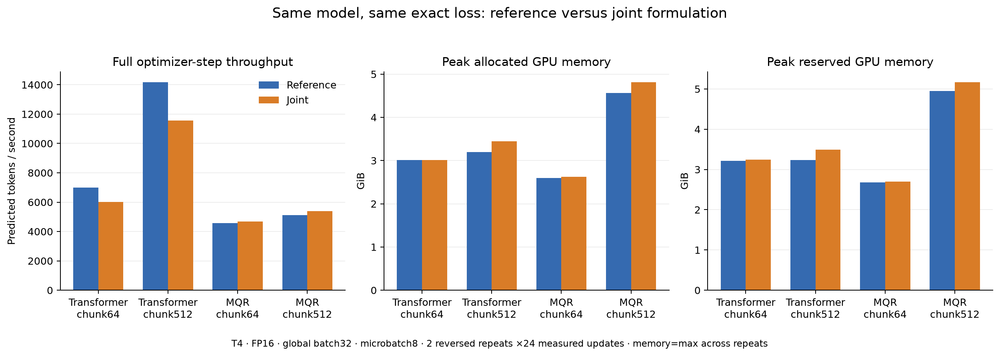
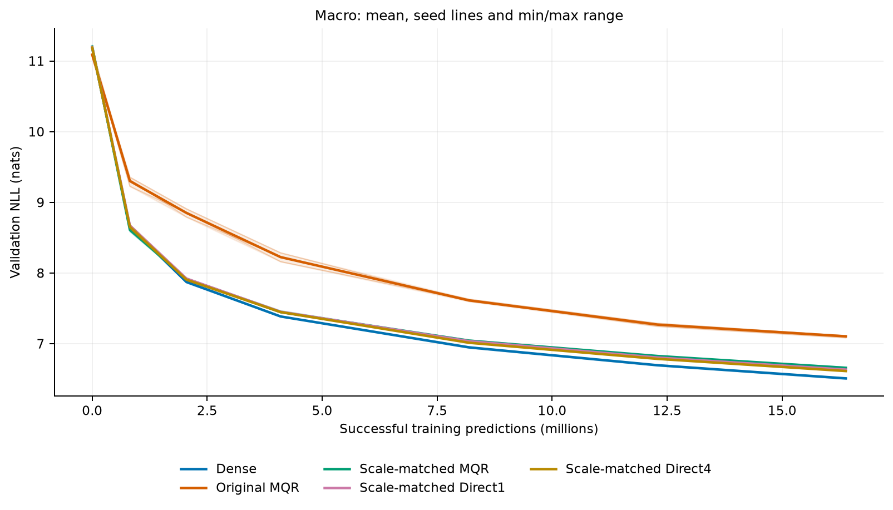
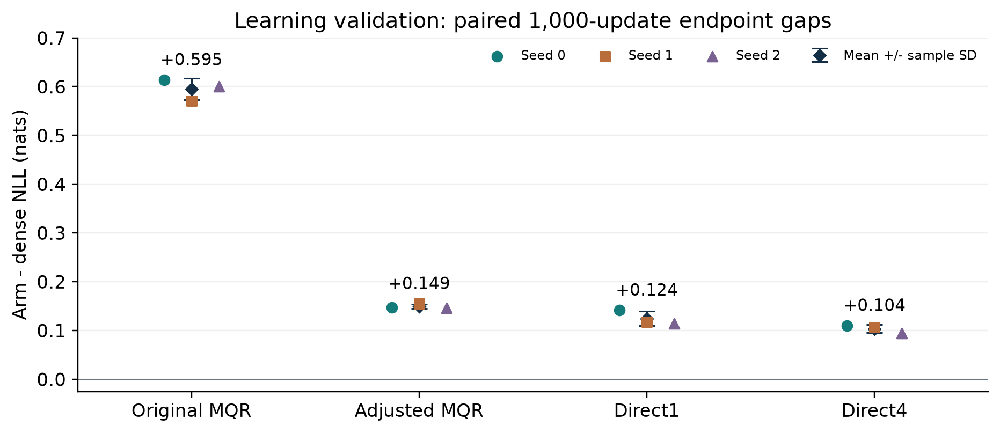
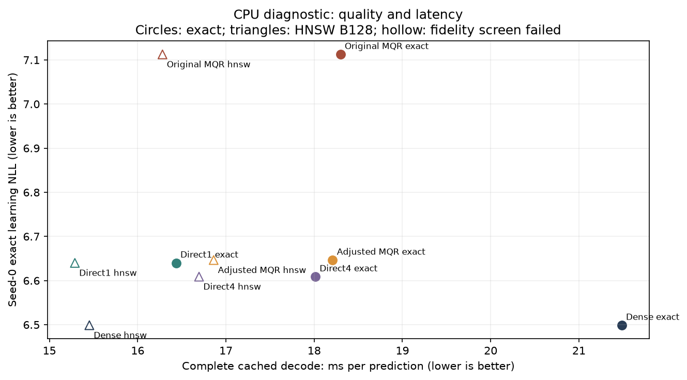
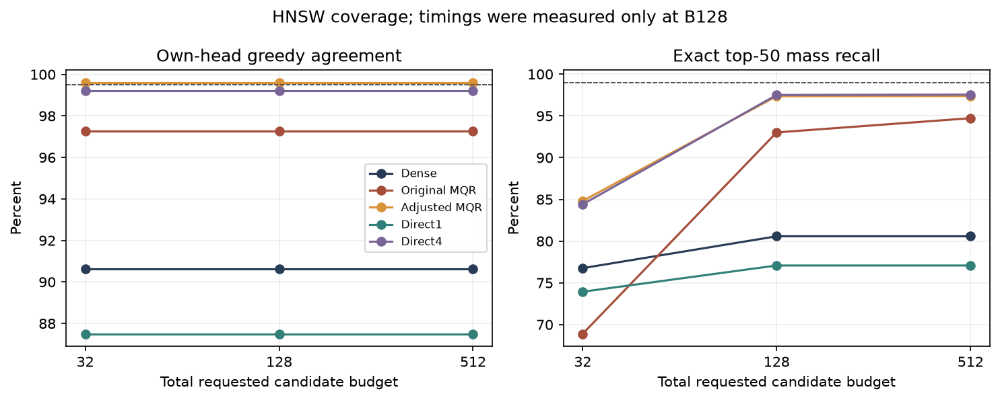
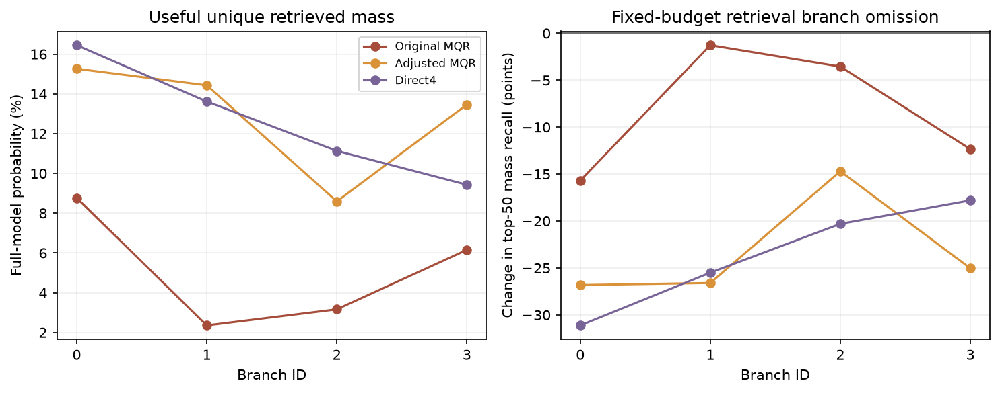

# MQR-LM: A Controlled Investigation of Multi-Query Vocabulary Heads

## Learning, retrieval fidelity, and CPU inference in a four-language prototype

Technical research report | Originally 25 October 2026; revised 28 October 2026 | MQR-v1

Evidence window: 22-28 October 2026. This report describes an independent, AI-assisted research project. It is a synthesis of recorded experiments and audits, with literature context; it is not a peer-reviewed publication. Training and inference measurements are distinguished throughout from proposals, software fixtures, and estimates. This revision adds the 27-28 October fixed-checkpoint vocabulary-search follow-up and the resulting project-closure decision.

## Abstract

This project tested whether a language model could replace a conventional dense vocabulary projection with a nonlinear concept map, multiple learned query vectors, and a shared lower-dimensional token table, obtaining a useful language-quality, latency, and memory tradeoff. MQR-v1 retained a conventional decoder and used globally normalized log-sum-exp aggregation over four 128-dimensional query scores. Training used exact full-vocabulary cross-entropy. A sequence of software checks, GPU calibration, initialization diagnostics, execution experiments, a five-arm three-seed learning confirmation, and a real-checkpoint CPU inference study evaluated the proposal.

The confirmation used a shared 65,536-token BPE and balanced English, German, Arabic, and Persian development data. All 15 runs completed 1,000 successful updates, or 16.384 million predictions per run. Dense achieved mean macro validation NLL 6.509684; original MQR 7.104622; initialization-adjusted MQR 6.659180; adjusted Direct1 6.633984; and adjusted Direct4 6.613376. Adjusted MQR lost to the nearly parameter-matched Direct4 control in all 12 seed/language endpoint comparisons. Larger loss chunks improved dense throughput especially strongly and removed MQR's earlier training-memory advantage.

On the 25 October seed-0 CPU study, exact adjusted MQR measured 18.209 ms per prediction, 15.25% below exact dense's 21.485 ms. However, exact Direct1 and Direct4 measured 16.436 and 18.013 ms while retaining better learning NLL. No HNSW arm/budget cell passed both registered retrieval-fidelity screens. Adjusted MQR's branches contributed distinct candidates, but this did not produce a competitive overall frontier. [P01-P12]

A separate fixed-checkpoint follow-up crossed three candidate budgets with four efSearch settings for dense, Direct1 and Direct4. None of the 36 tuning configurations met both fidelity thresholds. On disjoint confirmation documents, Direct4's diagnostic fallback achieved 100% greedy agreement but only 98.287% exact-top-50 probability-mass recall, below the required 99%. It took 20.339 ms per prediction versus freshly measured exact Direct4's 17.231 ms, an 18.04% slowdown. This follow-up changed neither weights nor activations and contained no MQR arm. The learning ablation supports closing MQR-v1's active concept-path investigation; the follow-up separately closes ordinary search-effort tuning in this fixed-graph range. Convergence, alternate activations, other index constructions and broader model scales remain untested. [P13, P14]

## Executive assessment

The principal result is negative for the tested architecture against strong controls. Three positive findings remain useful: initialization-scale calibration substantially improved learning without adding parameters; exact CPU scoring could benefit from the smaller shared output table; and the trained branches contributed useful distinct retrieval candidates. These findings explain parts of the mechanism without establishing the intended architectural advantage.

| Question | Recorded answer | Scope |
|---|---|---|
| Does adjusted MQR match dense learning NLL? | No; mean deficit +0.149495 nats | Three seeds, 1,000-update endpoint |
| Does the concept path beat Direct4? | No; mean deficit +0.045804 nats | Every paired endpoint seed/language cell |
| Can exact MQR be faster than dense on CPU? | Yes; 15.25% lower observed decode latency | Seed 0, one shared CPU host |
| Does MQR beat the strong Direct frontier? | No useful measured advantage | Quality, observed latency, structural storage |
| Does fixed HNSW meet both fidelity screens? | No; 0 of 15 arm/budget cells | Budgets 32/128/512, fixed index settings |
| Does ordinary search tuning rescue the Direct serving path? | No; 0 of 36 tuning cells pass jointly | Three arms; three budgets x four efSearch settings |
| Does Direct4's frozen fallback pass confirmation? | No; 100% greedy but 98.287% R50; 18.04% slower | Additional 32 validation documents; fresh exact baseline |
| Are all four adjusted-MQR branches useless? | No; fixed-budget omissions reduce coverage | Diagnostic evidence, not semantic labels |

The report first defines the model and evidence hierarchy, then follows the experimental sequence, presents the learning and inference results, and records limitations, corrections, and reproducibility anchors. The two CPU studies are reported separately. The appendices preserve per-language results, both complete HNSW grids, and source references.

## 1. Motivation and hypotheses

The original question was whether multiple learned vocabulary queries could represent alternative next-token regions more efficiently than one conventional output query. A lower-dimensional shared token table might reduce parameter storage and output-table traffic, while multiple queries might recover expressive or retrieval coverage lost by a single low-rank projection. The serving target was batch-one cached autoregressive decoding; GPU training was used to obtain meaningful learned checkpoints.

The project separated four testable claims. First, the head should retain competitive exact language-model likelihood. Second, multiple queries should contribute useful candidate coverage, beyond a single-query low-rank control. Third, the nonlinear concept path should add value beyond a direct four-query projection of almost identical parameter count. Fourth, any retrieval speedup should survive complete decoding and fidelity checks against dense-plus-ANN and the Direct controls. Fewer parameters alone would not establish any of these claims.

Early planning documents discussed an English mechanism pilot, a Pythia inference-first diagnostic, quantized dense, larger training budgets, and later translation or zero-shot evaluation. These were proposals. The Pythia comparison and quantized-dense baseline were not completed; the actual sequence ran training diagnostics before the final CPU serving study. The eventual 3B-token matrix, translation, and zero-shot branches were withheld. This report follows completed evidence rather than treating the entire original plan as executed. [P01, P02, P11]

## 2. Literature context and novelty boundary

Continuous-output sequence models provide precedent for replacing categorical output parameterizations with embedding-space predictions. Kumar and Tsvetkov's directional-output work concerns distributions over pretrained word embeddings and neural translation; its likelihood and training results do not automatically transfer to this learned-subword, exact discrete-CE head. [L1]

Yang and colleagues identify a rank limitation of a conventional softmax logit factorization and study mixtures of normalized token distributions. This motivates testing nonlinear combination, but MQR's global log-sum-exp scorer is not the same parameterization as their mixture-of-softmaxes model. The project therefore treats MoS as related work, not as a theorem that its own concept block must improve quality. [L2]

Approximate search over output vectors also predates this project. Vijayanarasimhan and colleagues studied large output spaces; Loretz and Hochreiter's 2026 preprint specifically investigates vector-index output embeddings for CPU decoding. Consequently, dense-plus-ANN is a required comparator and vocabulary retrieval itself is not a novelty claim. External throughput or generation-quality results are not measurements of MQR-v1. [L3, L4]

Chen and colleagues' AMER work uses multiple autoregressively generated vectors for document retrieval with multiple relevant targets. It motivates considering diverse query geometry, while leaving open whether parallel queries trained from a next-token likelihood can provide a useful vocabulary-head tradeoff. No Hungarian assignment or AMER training procedure was implemented in these experiments. [L5]

The systems interpretation follows two additional boundaries. Equal leading arithmetic does not force equal observed latency when data movement and matrix shapes differ, as captured by the Roofline perspective. ANN difficulty also depends on the indexed data and query distribution; a single model, host, or synthetic vocabulary crossover cannot settle every retrieval configuration. [L6, L7]

## 3. Architecture and probability contract

### 3.1 Shared decoder and output-head controls

The five confirmation arms shared a 12-layer decoder with model width 512, eight attention heads, FFN width 2048, context length 512, and vocabulary size 65,536. The implementation used a pre-normalized causal decoder with RoPE and a KV cache. Input and output embeddings were untied; dropout was zero in the frozen confirmation configurations. Within a seed, arms began with the same decoder weights, tokenizer, successful training windows, and schedule. Their decoder weights subsequently evolved separately. [P03, P07]

| Arm | Vocabulary head | Head parameters | Total parameters |
|---|---|---|---|
| Dense | 512-wide dense table | 33,554,432 | 104,913,920 |
| Original MQR | Concept256; 4 x 128 queries | 8,651,520 | 80,011,008 |
| Adjusted MQR | Same architecture; calibrated initialization | 8,651,520 | 80,011,008 |
| Direct1 | One affine 128-wide query | 8,454,272 | 79,813,760 |
| Direct4 | Four affine 128-wide queries | 8,651,264 | 80,010,752 |

Dense and MQR are matched by decoder geometry rather than total parameter count. Direct4 is the close capacity control for the concept pathway: it differs from MQR by only 256 parameters. Direct1 has 196,992 fewer parameters than Direct4 and represents an ordinary affine low-rank vocabulary readout. Four vocabulary queries do not mean four decoder attention heads.

### 3.2 Exact scorer

For the decoder's final normalized feature F, the concept head first applies an affine map and GELU, then forms M parallel queries. Every query uses the same learned output-token table E. The tested probability law is:

```text
C = GELU(F W_c + b_c)
q_j = C V_j + b_j                   j = 1,...,M
a_jv = q_j^T E_v
z_v = logsumexp_j(a_jv) - log(M)
p(v | F) = exp(z_v) / sum_u exp(z_u)
loss(F,y) = -log p(y | F)
```

The multi-query arms use M=4 and output width 128; MQR has concept width 256. Raw query and token-row magnitudes are learned. There is no learned branch gate, output-token bias, compulsory query/row normalization, or changed temperature. Subtracting log(M) is a constant across vocabulary entries and cancels in the final softmax for fixed M. Exact full-vocabulary CE is the training objective. Chunking changes execution, not this probability law. [P02, P03]

Equal coefficients inside the global aggregation do not imply equal branch probability mass. If Z_j is the sum of exp(a_jv) across the vocabulary, the aggregate distribution can be written as a mixture of branch-normalized distributions with effective weights Z_j divided by their sum. These weights arise from the component partition functions, rather than an independent learned mixture gate. Direct4's nonlinear aggregation is not proved equivalent to a rank-512 linear readout. [P02; L2]

### 3.3 Candidate inference

At inference, each query retrieves neighbors, the IDs are unioned and deduplicated, and every candidate is reranked with all original queries under the same scorer. Only normally scored EOS is always included. Observed gold tokens are never injected. Candidate-only normalization creates a truncated distribution and cannot replace full-model NLL.

Exhaustive per-query retrieval is not exhaustive aggregate retrieval. With two queries and token score pairs A=(10,-100), B=(-100,10), and C=(9.5,9.5), A and B are the per-query top-1 choices, but C has the highest aggregate log-sum-exp. The evaluation therefore distinguishes exact-union omissions from additional approximate-index error. [P02, P03, P10]

## 4. Implementation and data preparation

### 4.1 Research software

The implementation includes dense, direct and concept heads; causal decoding and KV-cache parity checks; exact chunked likelihood; optimizer/scaler/RNG/sampler checkpoints; deterministic global batches; replayable metrics after rollback; and Flat, exact-Faiss and HNSW retrieval. Numerical checks covered candidate reranking, head loss/gradient equivalence, masking, cached versus uncached decoding, checkpoint reload, and deterministic resume. Tiny synthetic tests demonstrate software behavior, not language quality or multilingual competence. [P03-P06]

Each remote phase used frozen source/data bindings, small provenance sidecars, finite execution limits, and evidence collection. Recorded agent reviews and automated audits are distinguished from independent human peer review. Large checkpoint bodies were reloaded remotely; the final five seed-0 inference bodies, totaling approximately 5.10 GB, were not downloaded to the laptop. [P08, P10]

### 4.2 Readiness corpus and broader development snapshot

Early GPU diagnostics used the readiness-v2 corpus with 2,445,800 balanced training tokens. Later confirmation used a larger development snapshot. Its acquisition stage recorded 64,512 candidate documents and 258,072,037 UTF-8 text bytes. The common source-quality filter retained 55,486 candidates before subsequent global duplicate/benchmark screening; the final selected snapshot contained 55,153 documents. These counts refer to different stages and are not interchangeable. [P04, P09]

English came from FineWeb, German and Arabic from FineWeb2, and Persian from mC4 with native Wikipedia. Acquired Persian FineWeb2 samples contained no observed original ZWNJ and were excluded from the confirmation inputs. Persian mC4 sampling used 16 seeded shards and three interior windows within each shard's first 8,192 rows; later rows had no chance of inclusion. The corpus is a bounded development sample rather than a representative sample of the full publishers' data. [P09]

| Split | Positions per language | Total positions | Use |
|---|---|---|---|
| Training | 6,549,926 | 26,199,704 | Balanced sampling pool |
| Validation | 775,909 | 3,103,636 | Development evaluation |
| Test | 814,053 | 3,256,212 | Locked for selection |

The 65,536-entry ByteLevel BPE was fitted on training text only. Its fitting ledger contains 29,460 training-document prefixes, totaling about 28.35 million original UTF-8 bytes per language. Exact prefixes, order and identities were audited. Token balancing preserved exactly equal usable split positions per language; the confirmation separately enforced equal successful training exposure per update. Available training positions are not the same as positions actually sampled during learning.

The prepared Persian training tokens were 94.9662% mC4 and 5.0338% native Wikipedia. The retained Persian training spans contained 137,312 original U+200C characters, and training-only tokenizer fitting included 94,336. No joiners or letter substitutions were fabricated. These preservation checks do not certify general Persian representativeness or human language quality. [P09]

### 4.3 Splits, decontamination, and evaluation banks

Persistent content/URL/ID identity groups were assigned to splits before filtering. Rejected documents were not reassigned, and the 971 historical holdout groups remained locked to test. The supplied exclusion bank covered FLORES-200, XNLI, FarsTail, OPUS-100, MNLI, and 971 historical holdout texts. Exact/ngram/approximate screening had a recorded scope; translated, paraphrased, or otherwise unrecognized contamination could remain. Language identification, common prose/repetition filters, and 400 bounded agent excerpt reviews reduced known risks but did not replace expert native-language certification. The test stream stayed locked for model selection. [P07, P09]

The learning validation bank contained 256 disjoint 513-token blocks per language, predicting 131,072 tokens per language, or 524,288 per evaluation. The blocks were held out by split, but EOS-packed blocks could span document boundaries. They were not 1,024 independent documents. The later inference bank was a distinct document-based validation workload: 32 complete documents, eight per language, and 256 teacher-forced prefix contexts. Its NLL must not be silently merged with the earlier learning-bank NLL. [P07, P10]

The search follow-up reused those 32 serving documents for tuning and froze 32 additional complete validation documents for confirmation. Persistent IDs and content hashes exclude overlap between phases. Each phase contains eight documents per language and 256 correlated prefix contexts. Confirmation remains within the same bounded development validation distribution; it is not a locked-test evaluation or an additional training seed. [P13]

## 5. Experimental sequence and decision points

| Stage | Date | Completed scope | Main purpose |
|---|---|---|---|
| Architecture/software definition | 22 Oct | Explicit scorer, controls, local checks | Make the hypothesis executable |
| Initial T4 calibration | 22 Oct | Dense/MQR, 120 updates each | Verify hardware path and cost |
| Batching and initialization | 23 Oct | 24 timing workers; 14 learning arms | Diagnose execution and scale |
| Loss-chunk experiment | 23 Oct | Four chunk sizes; fresh confirmation | Compare exact-loss cost/memory |
| Equivalent joint-loss audit | 23 Oct | Numerical gates and 16 timing workers | Test an execution-only candidate |
| Broader-data confirmation | 24 Oct | Five arms x three seeds x 1,000 updates | Compare learning at equal exposure |
| CPU serving diagnostic | 25 Oct | Five retained seed-0 checkpoints | Measure fidelity and complete decode |
| Direct search tuning and confirmation | 27-28 Oct | Three retained checkpoints; 36 tuning settings; disjoint confirmation | Test budget/search-effort tuning without new training |

This sequence involved evolving, documented decisions rather than one unchanged preregistration covering every stage. Historical projections and future controls are not retrospectively counted as completed experiments. The main learning and CPU workloads had their own frozen protocols and approval/evidence bindings. The final follow-up was authorized on 27 October, ran once, and was collected and analyzed after interruption without rerunning the notebook. [P01, P04-P14]

### 5.1 Initial GPU calibration

Both full-shape heads completed 120 successful updates, or 1,966,080 predicted tokens each, on one Tesla T4 per process. Microbatch 1 with accumulation 32 preserved 16,384 predictions/update; exact CE used position chunks of 64 and FP16 with gradient scaling. Checkpoint save/reload/resume was exercised and no AMP overflow occurred. Timing excluded the first 20 updates. Dense measured 4,287.41 predictions/s with peak allocated memory 2.16385 GiB; MQR measured 3,808.00 predictions/s and 1.74205 GiB. MQR therefore had lower throughput and lower allocator memory in this particular execution. [P04]

This calibration used an earlier long schedule and remained inside its warmup. Its last training-batch losses were 10.37783 and 11.05538; there was no validation-based quality comparison. Extrapolations of those rates to 3B tokens were planning calculations, not executed budgets or rental invoices. Later implementation/execution measurements require their own fresh baselines.

### 5.2 Initialization scale and the two-seed learning pilot

A small CPU probe on real training features found centered aggregate-logit standard deviations of 0.453748 for dense, 0.095311 for Direct1, 0.046950 for Direct4, and 0.008977 for MQR. The very small MQR score variation motivated a named initialization intervention. An unlabeled training-feature calibration multiplied only the existing final query-projection weights and bias to match dense's centered aggregate-logit scale. It added no learnable scalar, parameter, or inference operation. It also affected responsibility geometry and relative updates, so the diagnosis did not isolate gradient scale alone. [P05]

The batching sweep selected common microbatch 8 and accumulation 4. Fresh geometric-mean throughput was 7,240.26 predictions/s for dense and 4,656.35 for MQR; allocated peaks were 3.0135 and 2.5937 GiB. Microbatch 4 was within 0.22% of 8 for both, indicating a performance plateau rather than a uniquely optimal batch. The separate learning pilot tested seven arms across two seeds for 128 updates each, or 2,097,152 predictions per arm. [P05]

| Arm | Seed-0 NLL | Seed-1 NLL |
|---|---|---|
| Dense | 7.73669 | 7.73313 |
| Direct1 original | 7.94692 | 7.99089 |
| Direct4 original | 8.19681 | 8.15861 |
| MQR original | 8.77945 | 8.75979 |
| Direct1 adjusted | 7.75924 | 7.76392 |
| Direct4 adjusted | 7.76337 | 7.74647 |
| MQR adjusted | 7.75834 | 7.78309 |

This learning pilot used fresh weights, 16 warmup updates, peak LR 3e-4, and a 256-update cosine horizon stopped at 128. Evaluations at steps 0/16/32/64/128 used 16 fixed windows per language, or 32,768 predictions per evaluation. These settings differ from the later confirmation's schedule and larger bank.

Adjusted MQR closed 97.92% and 95.13% of the original MQR-versus-dense endpoint gaps in these two seeds. Dense still had lower macro NLL. The shorter readiness pilot did not establish a concept-path advantage or forecast that the residual gap would disappear with more training. Calibration was repeated per seed and per study; pilot gains were not copied as universal constants. [P05]

### 5.3 Loss-chunk execution

The next experiment changed only exact-loss position chunk size, screening 64, 128, 256 and 512 while preserving the model, data, effective batch and probability law. Fresh reversed-order confirmation compared 64 with 512. Dense improved from 6,945.32 to 13,609.25 predictions/s (+95.95%); MQR improved from 4,549.00 to 5,063.92 (+11.32%). At common chunk512, allocated peaks were 3.1975 GiB for dense and 4.5637 for MQR. MQR then used 42.73% more allocated memory and had 62.79% lower throughput. [P06]

The earlier chunk64 memory saving remained a valid configuration-specific observation. It was not a persistent architectural guarantee. Position chunking, matrix work, FP32 aggregation intermediates, and activation/loss execution affected the observed training peak. Total parameter count did not predict that peak.

### 5.4 Algebraically equivalent joint loss

A separate artifact-only candidate evaluated the same exact likelihood through a joint reduction. Ten numerical gate families preceded 16 timing workers, including FP32 references, FP16 losses/feature/parameter gradients, stressed features, masks, unequal valid-token microbatches, and short actual optimizer trajectories. The largest recorded same-chunk FP16 head-loss difference was 7.63e-6 nats and the largest head-gradient-group relative L2 difference was 0.000204. The numerical/evidence audit passed. [P06b]

At chunk512 the candidate improved MQR from 5,106.8 to 5,387.6 predictions/s (+5.50%), with approximately 0.248 GiB more peak allocated memory. Dense slowed from 14,167.1 to 11,566.5 predictions/s (-18.36%). At chunk64 the MQR gain was only 2.71%. These are execution results, not a new model objective or quality result. The broader learning confirmation retained the common reference CE with chunk512 rather than promoting different per-head loss backends.



## 6. Five-arm, three-seed learning confirmation

### 6.1 Frozen design

Each arm/seed completed 1,000 successful optimizer updates, with global batch 32 at context512: 16,384 predictions/update, exactly 4,096 per language. The total was 16.384 million predictions per run and 245.76 million across 15 runs. This exposure is smaller than the available 26.20 million training positions, and random windows do not imply unique corpus traversal. Successful batches were paired within seed and replayed independently on CPU. [P07, P08]

The actual configuration used FP16 training with gradient scaling; microbatch 8/accumulation 4; AdamW-style optimizer settings with LR 3e-4, weight decay 0.1, betas (0.9, 0.95), gradient clipping 1.0; and common reference CE with chunk512. A 50-update warmup and 4,000-update cosine horizon, with floor 0.1 of peak, were frozen before training. The job stopped at update 1,000 along that schedule. It did not complete the schedule or demonstrate convergence. Original and adjusted MQR were distinct training runs. [P07]

Exact validation occurred at steps 0, 50, 125, 250, 500, 750 and 1,000; the seed-0 integration prefixes added step-2 checks. All five seed-0 prefixes passed before the longer queue. All 15 final runs passed the strict frozen audit, including remote CPU checkpoint reload records and replay of 3,000 successful per-seed batch trajectories. There were zero recorded AMP overflows. The short-endpoint +0.10-nat screen context and +0.03-nat paper-quality target were retained as context, not silently redefined after seeing the results. [P07, P08]

### 6.2 Endpoint results

| Arm | Mean macro NLL | Gap vs dense +/- paired SD | Worker minutes | Peak allocated GiB |
|---|---|---|---|---|
| Dense | 6.509684 | reference | 20.650 | 3.200 |
| Original MQR | 7.104622 | +0.594938 +/- 0.022096 | 58.605 | 4.566 |
| Adjusted MQR | 6.659180 | +0.149495 +/- 0.004614 | 58.763 | 4.566 |
| Direct1 | 6.633984 | +0.124300 +/- 0.014704 | 16.415 | 2.683 |
| Direct4 | 6.613376 | +0.103692 +/- 0.008338 | 60.010 | 4.566 |

Lower NLL is better. The paired gap SD is the sample standard deviation across three seed differences, not a confidence interval and not twelve independent language replications. Worker clocks include recorded initialization, optimizer attempts, evaluation and other work under shared-host execution. They are not isolated throughput, measured FLOPs, inference timing, or billing. Training allocator peaks include validation where recorded and exclude driver/other-process memory. [P08]

Dense achieved lower endpoint NLL in every paired seed and every language on the learning validation bank. Adjusting initialization reduced the mean MQR deficit by about 74.9%, but adjusted MQR still trailed dense by 0.149495 nats. Adjusted MQR also lost to Direct4 in all 12 endpoint seed/language cells: mean macro difference +0.045803567, paired sample SD 0.007325955, and SE 0.004229642. This is strong evidence against the tested concept pathway at this endpoint, while not isolating GELU alone: the ablation changes bottleneck depth/width and optimization geometry as well as nonlinearity.

Direct4 improved NLL over Direct1 by 0.020608456 nats on average, while Direct1 had lower recorded time, allocator memory, and parameter count. Direct1 therefore did not strictly dominate Direct4 in quality. It provided a conventional compression/cost alternative rather than evidence for concept-head novelty.



### 6.3 Learning trajectories and language breakdown

Adjusted MQR's mean gaps against dense at updates 250/500/750/1,000 were 0.062312/0.095126/0.130587/0.149495 nats. Against Direct4 they were 0.000394/0.029951/0.040410/0.045804. Adjusted MQR led Direct4 at step 50, but its late ordering worsened. Mixing the dense and Direct4 trajectory baselines would misstate the evidence. Continued improvement within every arm leaves convergence open; it does not provide positive evidence that a longer continuation would reverse the ranking. [P08, P11]

| Language | Dense | Original MQR | Adjusted MQR | Direct1 | Direct4 |
|---|---|---|---|---|---|
| English | 6.214426 | 6.752516 | 6.349637 | 6.321719 | 6.303800 |
| German | 6.708801 | 7.272251 | 6.848683 | 6.828127 | 6.810176 |
| Arabic | 6.870693 | 7.498380 | 7.036740 | 7.004625 | 6.996561 |
| Persian | 6.244817 | 6.895341 | 6.401658 | 6.381467 | 6.342967 |

These are within-language comparisons under one tokenizer. Absolute cross-language token NLL does not rank comparative fluency: token fertility and underlying text distributions differ. The loss deficit was not confined to Persian, nor was a differential tokenizer, data, or successful-exposure confound found in the frozen audit.



### 6.4 Compute accounting

The confirmation recorded 9.608 summed optimizer-attempt device-hours, 10.722 summed worker device-hours, 7.366 hours of whole-queue wall time, and a 14.731 GPU-hour upper bound from reserving two T4s for the queue. These are different scopes and cannot be substituted for an invoice, an isolated hardware efficiency ratio, or a forecast for a new job. The 25 October CPU notebook added 1,461.25 seconds of notebook wall time; the 27 October search follow-up added a separate 833.46 seconds, including setup and finalization. Neither CPU run reserved a GPU. A complete monetary total for the entire project was not established. [P08, P10, P13]

## 7. Real-checkpoint CPU inference study

### 7.1 Workload and fidelity definitions

The private CPU notebook processed the five retained seed-0, update-1,000 checkpoints serially. The actual host reported an Intel Xeon CPU at 2.20 GHz, four logical CPUs, approximately 33.66 GB physical RAM, Python 3.13.15, Torch 2.11.0+cpu, NumPy 2.1.3 and Faiss 1.15.1. Weights, search reference and execution used FP32 with two Torch/Faiss threads. Accelerator and notebook internet were disabled; requested image/source/privacy/attachments and full checkpoint hashes were checked. [P10]

The frozen bank selected complete, uncropped validation documents with at least 257 text tokens, using a seeded hash ranking within language. Eight prefixes from the first 257 tokens per document yielded 256 contexts at lengths 32 through 256. This favors eligible longer documents and early-document contexts. Coverage compared exhaustive PyTorch per-query retrieval, exact Faiss and HNSW at total requested budgets 32, 128 and 512, divided across queries. HNSW used graph M=32, efConstruction=200 and efSearch=128. Budget means requested search results before deduplication; the candidate union may be smaller and can add one normally scored EOS. These fixed settings were not an exhaustive ANN tuning sweep.

The registered point screens required at least 99.5% own-head greedy agreement and 99% exact-top-50 probability-mass recall. For each context, the latter is the probability mass of covered exact-top-50 tokens divided by the full exact-top-50 mass; reported values average these per-context ratios and then take an equal-language macro mean. Full retained probability, top-50 set recall, gold inclusion, and per-language values were also retained. Passing the point screen on correlated contexts would not certify a population lower confidence bound. Exact full-head baselines have perfect own-head retrieval fidelity by definition.

### 7.2 Timing design and complete decode

Timing was measured only at B128, batch one, using the first two bank documents per language and prefixes 32/128: 16 request cells per model and method. Requests predicted 16 tokens, with one warmup and three raw repeats. Exact/HNSW order alternated. Within a checkpoint both methods used that model's same forced exact continuation; continuations could differ across checkpoints. Head, prefill, first prediction, complete cached decode, combined prefill-plus-decode and backbone-only costs were measured separately. The primary decode contains 16 head predictions and 15 cached backbone steps. [P10]

Head share came from a separate instrumented forced decode. Search/transfers/union/rerank profiling was also separate. Summing instrumented stage medians did not replace primary complete-request timing. Table values below are arithmetic means of the 16 request-cell medians; raw repeats are retained and no publication-grade tail interval is claimed.

| Arm | Exact ms/pred. | HNSW ms/pred. | Exact combined ms/16 | HNSW combined ms/16 | Exact head share |
|---|---|---|---|---|---|
| Dense | 21.485 | 15.453 | 427.90 | 329.22 | 31.1% |
| Original MQR | 18.297 | 16.281 | 372.80 | 342.44 | 21.2% |
| Adjusted MQR | 18.209 | 16.861 | 372.66 | 354.20 | 21.3% |
| Direct1 | 16.436 | 15.288 | 347.74 | 327.62 | 12.5% |
| Direct4 | 18.013 | 16.696 | 371.47 | 346.92 | 21.0% |

Exact adjusted MQR reduced observed latency by 15.25% versus exact dense, despite equal dominant score MACs in this geometry. However, Direct1 exact was faster and had better learning NLL with fewer parameters; Direct4 exact had better NLL with slightly lower observed time at virtually identical parameter count. Small shared-host timing differences are not asserted statistically significant. No MQR path demonstrated the practical target of at least 10% lower complete decode latency against the eligible controls at matched fidelity and no worse learning NLL. [P10-P12]



### 7.3 Coverage and ANN error

| Arm / B128 | Exact-union top-50 mass recall | HNSW greedy | HNSW top-50 mass recall | HNSW retained mass | Gold omissions |
|---|---|---|---|---|---|
| Dense | 100.000% | 90.625% | 80.578% | 43.910% | 52.344% |
| Original MQR | 97.596% | 97.266% | 93.018% | 41.736% | 57.031% |
| Adjusted MQR | 99.997% | 99.609% | 97.356% | 53.039% | 47.656% |
| Direct1 | 100.000% | 87.500% | 77.079% | 42.053% | 56.641% |
| Direct4 | 99.972% | 99.219% | 97.506% | 51.364% | 47.266% |

No HNSW arm/budget cell passed both screens: zero of 15, including B512. Adjusted MQR at B128 met aggregate greedy agreement (99.609%) but missed mass recall (97.356%). Its exhaustive B128 union recalled 99.997% of top-50 mass, separating substantial additional ANN error from a negligible exact-union omission in that cell. Original MQR's exact B128 union recalled only 97.596%, so not every head's loss came solely from ANN. No B32/B512 latency result is inferred from these coverage measurements.

Adjusted MQR B128 HNSW retained 53.039% of total model probability and omitted the observed gold in 47.656% of contexts. English greedy agreement was 98.438%; top-50 mass recall was 98.256% English, 98.606% German, 96.506% Arabic and 96.058% Persian. The aggregate number does not remove these language differences. The full per-language table and budget grid appear in the appendices. [P10]



### 7.4 Branch contribution

For each token, branch responsibility was softmax over component scores; marginal branch mass was its expectation under the original full-model token distribution. The study measured query norms/cosines, marginal entropy, expected token-responsibility entropy, useful branch-unique retrieved mass, and leave-one-retrieval-branch-out coverage. Omissions redistributed the same total requested budget among the remaining queries, kept the original full-query scoring law, and excluded common EOS from branch-unique mass. Single-query omission was explicitly inapplicable.

Adjusted MQR at HNSW B128 had mean pair cosine 0.049, mean per-context normalized marginal entropy 0.943 and mean normalized expected token-responsibility entropy 0.180. The four branches uniquely retrieved, on average, 15.26%, 14.43%, 8.59% and 13.46% of full-model probability. Omitting one branch lowered top-50 mass recall by 14.70-26.82 percentage points and greedy agreement by 12.50-33.59 points despite budget redistribution. These observations argue against treating its queries as identical or wholly useless. Direct4 also showed material branch contributions. Geometry and distinct retrieved mass are not proof of semantic specialization and do not erase the concept-path learning deficit. [P10]



### 7.5 Own-feedback generation and cold requests

One fixed 128-token prompt per language was decoded greedily with exact or HNSW own-token feedback, up to 32 new tokens, retaining EOS, sequence lengths, first divergence and later-state coverage. Entire traces matched for 0/4 dense prompts, 3/4 original MQR, 2/4 adjusted MQR, 1/4 Direct1 and 4/4 Direct4. This small prompt set is separate from teacher-forced coverage; it is not a human quality, translation, or downstream benchmark. Four matching Direct4 traces do not override its failed bank-level fidelity screen. [P10]

| Arm | FP32 model MiB | HNSW index MiB | Initial build s | Cold request s | Identical traces /4 |
|---|---|---|---|---|---|
| Dense | 400.21 | 145.01 | 30.02 | 30.50 | 0 |
| Original MQR | 305.22 | 49.01 | 10.90 | 11.03 | 3 |
| Adjusted MQR | 305.22 | 49.01 | 12.85 | 11.24 | 2 |
| Direct1 | 304.47 | 49.01 | 12.08 | 10.28 | 1 |
| Direct4 | 305.22 | 49.01 | 12.02 | 10.29 | 4 |

One observed cold-index request per arm inclusively measured a fresh HNSW build, fingerprint validation and own-feedback generation in an already resident model/warm process. It excluded model/process startup. All five observed warm/cold sequences matched. Fresh graphs can change approximate neighbors, so the protocol retains token comparisons rather than assuming agreement. Initial index-build and cold-request values are separate observations, not components to add across different runs or an amortization estimate.

Structural FP32 parameter bytes, serialized index bytes and KV bytes were recorded separately from actual RSS. Maximum initial timed-prefix KV storage was 6 MiB for every arm. Warm-serving process RSS snapshots were approximately 1.201/1.210/1.243/1.276/1.247 GiB in execution order. Sampled construction maxima and lifetime high-water marks have different scopes. Because all models shared one process, retained allocator pages and earlier loads invalidate isolated per-model RSS ordering. A quantized-dense deployment comparison was not run.

### 7.6 Fixed-checkpoint search follow-up design

The follow-up tested whether ordinary HNSW candidate-budget and search-effort tuning could produce an eligible CPU operating point for Direct4, retaining dense and Direct1 controls. It used their seed-0, update-1,000 checkpoints, exact original scoring, FP32 and two Torch/Faiss threads. MQR was not an arm of this study. No weights, activations, query counts or widths were changed, and no training, quantization or GPU serving was performed. [P13]

Total requested candidate budgets 128/256/512 were crossed with efSearch 128/256/512/1024: 12 settings per arm and 36 overall. Graph M=32 and efConstruction=200 stayed fixed, and one graph per arm was reused. All candidate IDs were reranked with every original query; only normally scored EOS was always included. The tuning bank reused the earlier serving documents, while confirmation used the additional 32 documents described in Section 4.3, selected with seed 2026102701 before new measurements.

Selection used tuning results only: choose the fastest configuration satisfying at least 99.5% own-head greedy agreement and 99% top-50 mass recall. When none passed, the predeclared deterministic fallback rule selected a diagnostic configuration. Each selection record was committed before confirmation features or metrics were evaluated. A fallback could not become eligible through confirmation alone. Timing used eight tuning request cells and 16 confirmation cells, with prefixes 32/128, one warmup and three raw repeats per cell. Complete cached decode contained 16 predictions and 15 cached backbone steps, following matched forced exact continuations within each checkpoint. [P13]

### 7.7 Tuning and separate confirmation results

None of the 36 tuning configurations met both fidelity thresholds. Some Direct4 settings passed greedy agreement alone. Every selected configuration below is therefore a diagnostic fallback, rather than a promoted winner. Appendix E retains the entire tuning grid. [P13, P14]

| Arm | B / efSearch | Tuning eligible /12 | Confirmation greedy | Confirmation R50 | Total mass |
|---|---|---|---|---|---|
| Dense | 128 / 1024 | 0 | 87.500% | 80.621% | 44.749% |
| Direct1 | 256 / 1024 | 0 | 87.109% | 75.052% | 44.375% |
| Direct4 | 512 / 1024 | 0 | 100.000% | 98.287% | 66.063% |

R50 denotes probability-mass recall inside the exact top-50 set, using the same per-context ratio and equal-language macro reduction as the first study. Total mass uses the entire original vocabulary distribution as its denominator. These columns measure different quantities.

| Arm | Exact ms/pred. | ANN ms/pred. | ANN latency change | Exact combined ms/16 | ANN combined ms/16 |
|---|---|---|---|---|---|
| Dense | 20.203 | 15.954 | -21.03% | 397.75 | 331.88 |
| Direct1 | 15.545 | 15.995 | +2.90% | 323.77 | 333.55 |
| Direct4 | 17.231 | 20.339 | +18.04% | 348.01 | 398.81 |

Positive ANN latency change means slower than that arm's newly measured exact path; negative means faster. Exact baselines were remeasured in the follow-up and are not substituted from 25 October. Each value is the mean of request-cell medians. Dense's lower ANN latency fails fidelity substantially; Direct1 is 2.90% slower; Direct4 is 18.04% slower and still misses R50. None establishes a matched-fidelity speed advantage. Cross-model forced continuations can differ, and no uncertainty interval or statistical significance is claimed.


Fresh exact timings preserve the descriptive ordering Direct1 < Direct4 < dense. The existing three-seed learning NLLs remain 6.633984, 6.613376 and 6.509684 respectively; those values were not remeasured in this serving study. Exact compact-head tradeoffs remain useful controls within the original quality deficit and measurement limits. [P08, P13]

### 7.8 Distribution coverage and bounded follow-up conclusion

For Direct4 confirmation at B512, exhaustive per-query union retrieval reaches 100% R50 but retains only 67.862% of total model probability. HNSW at B512/efSearch1024 reaches 98.287% R50 and retains 66.063%. Additional ANN error remains, while substantial full-distribution truncation persists even under exhaustive per-query retrieval. The 100% greedy agreement in this finite confirmation sample cannot establish preservation of the sampling distribution. Candidate-normalized NLL is not reported as exact full-vocabulary NLL. [P13]

| Language | Greedy | R50 | Total mass |
|---|---|---|---|
| English | 100.000% | 99.342% | 70.821% |
| German | 100.000% | 98.521% | 66.480% |
| Arabic | 100.000% | 96.997% | 60.851% |
| Persian | 100.000% | 98.289% | 66.102% |

The language breakdown also shows that perfect observed greedy agreement does not imply uniformly high mass coverage. The bounded conclusion is that ordinary budget/efSearch tuning of these fixed HNSW graphs did not produce a jointly eligible fidelity/cost improvement. One seed, one shared CPU host, one graph per arm, correlated prefixes, a finite grid and finite timing repeats limit the conclusion. Other graph constructions and different model geometries were not tested. [P13, P14]

## 8. Audit trail, operational failures, and corrections

The strict learning audit checked frozen source/package/data identities, optimizer counters and LR values, initialization scope, recorded memory, validation joins and remote checkpoint reload records. All 15 workers completed. Its CPU replay covered 3,000 successful per-seed batch trajectories, and three languages beyond English were not counted as extra independent model seeds. Full checkpoint bodies stayed on Kaggle; local checks used the recorded remote reload/hash evidence. [P08]

Learning collection initially failed after the notebook completed because a file-list endpoint returned colliding basenames and incorrect lengths. A separate recovery used unique full output paths and mandatory consistent logged archive length/hash receipts, with version/source/privacy/runtime guards before and after collection. The failed collection was preserved; no GPU rerun was needed. Earlier transient status-read failures recovered, and their precise cause was not established. [P08]

The CPU notebook completed within its ceiling and collection preserved a 3,112,759-byte ZIP containing 72 files. The CPU audit checked recorded arithmetic/completeness and externally pinned provenance without local checkpoint reload. The complete audit covered 11,520 coverage rows, 11,520 branch rows, 160 timing rows, 40 integration cases and 60 generation/comparison records. Source and frozen core members remained unchanged. Notebook wall was 1,461.25 seconds, core wall 1,437.82 seconds; setup and finalization counted toward the 14,400-second notebook budget. [P10]

The first external CPU audit failed on branch-marginal sanity checks with a 1e-6 tolerance. The frozen core reduced 65,536-term FP32 probabilities, with a maximum unit-total deviation of 0.0000466108. A separate local synthetic softmax under Torch 2.14.1+cpu, rather than the remote Torch 2.11.0+cpu, reproduced drift above 1e-6. It demonstrates plausible FP32 drift without reproducing the trained checkpoint or proving a universal numerical bound. The correction introduced a separately named 1e-4 tolerance only for branch-marginal upper-bound and unit-total checks. It did not clamp or renormalize observations, alter fidelity screens, change candidate/cache gates, edit the frozen protocol/code, or rerun the experiment. The original failed audit and validator were preserved. This was a retrospective checker correction, not a hidden experimental change. [P10, P12; L8]

The corrected validator passed 38 fixtures, including five added regressions, and the real complete audit passed as `audit_v2.json`. The final analysis rechecked raw-file hashes and retained the correction disclosure; five reporter fixtures included a full CLI/plot/hash-inventory case. Software fixture counts describe particular test runs and must not be pooled into scientific replication counts. Neither automated audit nor AI-agent review establishes external peer-review acceptance.

The search follow-up submitted one private CPU notebook version 1 at 17:08:44 UTC on 27 October and completed in 833.46 seconds, within its 14,400-second ceiling. The actual host again reported an Intel Xeon at 2.20 GHz, four logical CPUs, two Torch/Faiss threads, Torch 2.11.0+cpu and Faiss 1.15.1. Local prepared package v3 was the final package; earlier local preparations were not uploaded or launched. The remote dataset and notebook were both version 1. The first collector ended with SystemExit during the interruption. Its record remains in `collection_v1`; read-only recovery into `collection_v2` downloaded the completed output without a rerun. The recovered evidence ZIP contains 42 files and 5,542,328 bytes. [P13]

The new external arithmetic/completeness audit passed 14,592 coverage rows, 1,536 exact-reference rows and 504 raw timing records. It reconstructs candidate membership, greedy/gold joins, top-50 coverage, language/macro reductions, timing medians, grid completeness and tune-only selection. Full retained probability is source-bound and checked for consistency, rather than independently recomputed by locally reloading a model body. The worker's parameter-immutability and score-parity guards are likewise preserved source/measurement evidence. Thirty-six prelaunch worker/orchestration fixtures and 26 auditor fixtures passed; these are software checks. Original frozen experiment files, thresholds and the earlier failed collection record were preserved. [P13]

## 9. Interpretation and limitations

### 9.1 Findings supported by the completed evidence

Initialization was a material weakness in the original prototype. Calibration improved the short pilot and broader confirmation without adding parameters, but its early gap closure did not predict parity at the longer endpoint. The concept pathway failed its nearly parameter-matched Direct4 ablation at the studied budget. Multi-query branches could provide distinct retrieval candidates without improving learning NLL or the complete serving frontier. Training execution effects were large enough to reverse the sign of a memory comparison. Exact CPU latency could improve even when leading score arithmetic was equal.

Taken together, these observations favor the Direct controls over the tested MQR implementation. Direct1 exact provides a measured conventional tradeoff: 23.50% lower observed CPU decode latency and approximately 23.9% fewer parameters than dense, with a +0.124300-nat three-seed learning deficit. Dense retains the best learning NLL; Direct4 retains better NLL than Direct1. No single control dominates all others on every metric. [P08, P10]

The later serving sweep adds a narrower negative result: increasing ordinary candidate budget and efSearch did not make any of the tested Direct/dense HNSW paths jointly eligible. Direct4's highest-coverage tuning choice remained below the mass-recall requirement on confirmation while costing more than its exact path. This does not constitute a new MQR learning comparison or a test of an alternate activation. [P13, P14]

### 9.2 Limits on causal and statistical interpretation

The learning comparison has only three model seeds and stops at 1,000 updates on a 4,000-update schedule. It is negative at that endpoint, not a convergence proof. The development corpus is small and conditionally sampled, with residual domain noise, language mixing and incomplete decontamination coverage. Evaluation blocks and prefixes are correlated. Cross-language NLL is tokenizer/distribution dependent. The ablation changes several properties of the concept pathway together and cannot isolate a universal effect of GELU or bottleneck width.

Each inference study uses one trained seed, one shared CPU host and three repeats per timed cell. The first used 32 documents and fixed ANN search effort. The follow-up reused those documents for its finite tuning grid and added 32 disjoint confirmation documents from the same validation distribution. It held graph construction fixed and did not replicate graphs or trained seeds. Method pairing controls forced trajectories within a model, while cross-model hidden states and continuations differ. Hardware contention and serial model order can influence timing. Raw observations are retained, but no tail-latency confidence bounds or isolated per-model RSS comparison is claimed. Fidelity screens are correlated-context point summaries. Different graphs, hardware or distributions remain untested.

The study did not evaluate quantized dense, adequately trained alternate query widths, true MoS, distillation, gates/diversity objectives, larger trained vocabularies, GPU-serving latency, downstream NLI, translation, zero-shot transfer, or human-rated generation. Random or duplicated rows would create a synthetic search stress test, not a trained enlarged-vocabulary LM. Editing a retained checkpoint from width128 to width64/256 would be a new compression intervention, not evaluation of separately trained architectures.

### 9.3 Implications for theory and prior critiques

Dense's 512 x 65,536 score product and four 128 x 65,536 products have equal dominant score MACs, but the FP32 output tables occupy 128 and 32 MiB. The observed CPU result invalidates a claim that equal MACs alone prohibit a latency gain. Conversely, a smaller table did not guarantee better training allocator memory or a win against Direct1. The experiment did not isolate memory bandwidth as the causal source of the timing difference. [L6]

Head parameter share cannot substitute for measured head time in Amdahl's law. The CPU study observed separate instrumented head fractions instead. Global-LSE aggregation is not automatically identical to a mixture of separately normalized softmaxes, and Direct4 is not justified as a rank-512 linear classifier merely by multiplying query count and width. Dense-plus-ANN preserves the underlying exact checkpoint distribution but can change approximate decoding through omissions. These distinctions prevent theoretical overclaim in either direction. [P02, P11; L2]

## 10. Decision and research contribution

As of 28 October, the project decision is to close MQR-v1's current active investigation and preserve its code, experiment records, audit corrections and negative report. The concept-path decision rests principally on the five-arm, three-seed learning comparison: initialization helped substantially, yet adjusted MQR lost to the nearly parameter-matched Direct4 in all 12 paired seed/language cells. The first CPU study found no compensating practical frontier. The later Direct-only study separately closes ordinary fixed-graph search tuning within its registered range; it adds no new learning evidence against the concept path. [P08, P12-P14]

Closure is a research decision under the tested budget and controls. It does not require exhausting every possible modification. Learning stopped before the full schedule, and an activation sweep was never run, so the evidence cannot establish convergence or a universal effect of GELU. A generic possibility that another activation might help is insufficient to reopen this completed investigation without a specific mechanism and a discriminating experiment. No new training, 3B-token matrix, GPU inference, vocabulary/width sweep, translation or zero-shot study was launched as part of this revision. [P13, P14]

A future investigation would need a specific hypothesis addressing the measured learning deficit or a demonstrably different serving regime, with strong Direct/dense controls and an appropriate quantized baseline before broad systems-superiority claims. Such possibilities are research questions rather than reasons to reinterpret an unfavorable completed comparison as success.

The project's defensible contribution is a documented empirical investigation: an explicit probability/scoring contract; implementation and reproducibility machinery; initialization diagnosis; evidence about execution-sensitive training memory; a controlled concept-path ablation; and fidelity/cost accounting with a prospectively separated serving follow-up. These are research artifacts. No claim of a novel superior language model, general architectural impossibility, or publication acceptance follows.

## 11. Reproducibility, availability, and AI assistance

This report was assembled from local records without retraining or reloading the large checkpoint bodies. Its accompanying evidence ledger binds referenced local files and copied figures by SHA-256. The Markdown source and PDF build script are editable. The underlying training/inference audits remain the authority for their respective experiments; creating this report does not replace them with a new audit.

Source modules, analysis records and small outputs are retained in the workspace. Full model/optimizer checkpoints remain in private Kaggle outputs; the report is not evidence that these or the corpus have been publicly released. A reader outside the workspace needs the corresponding source/evidence package and authorized checkpoint access for full reproduction. Package, tokenizer, source-map and key audit hashes are recorded below.

The researcher supplied the hypothesis and project direction. Codex and other AI agents supported implementation, experiment orchestration, evidence checks, analysis and report preparation. Recorded independent checks refer to separately executed automated/agent reviews unless explicitly identified otherwise. This assistance is disclosed so that software generation, numerical validation, scientific interpretation and personal contribution are not conflated. The report is not an assertion of independent human peer review.

## Appendix A. Complete 25 October HNSW screen grid

| Arm | Budget | Greedy agreement | Top-50 mass recall | Retained mass | Joint screen |
|---|---|---|---|---|---|
| Dense | 32 | 90.625% | 76.764% | 35.283% | fail |
| Dense | 128 | 90.625% | 80.578% | 43.910% | fail |
| Dense | 512 | 90.625% | 80.578% | 48.710% | fail |
| Original MQR | 32 | 97.266% | 68.896% | 29.001% | fail |
| Original MQR | 128 | 97.266% | 93.018% | 41.736% | fail |
| Original MQR | 512 | 97.266% | 94.721% | 54.603% | fail |
| Adjusted MQR | 32 | 99.609% | 84.810% | 39.534% | fail |
| Adjusted MQR | 128 | 99.609% | 97.356% | 53.039% | fail |
| Adjusted MQR | 512 | 99.609% | 97.382% | 66.057% | fail |
| Direct1 | 32 | 87.500% | 73.938% | 34.160% | fail |
| Direct1 | 128 | 87.500% | 77.079% | 42.053% | fail |
| Direct1 | 512 | 87.500% | 77.079% | 45.995% | fail |
| Direct4 | 32 | 99.219% | 84.406% | 38.429% | fail |
| Direct4 | 128 | 99.219% | 97.506% | 51.364% | fail |
| Direct4 | 512 | 99.219% | 97.548% | 64.009% | fail |

The joint screen requires both greedy agreement >=99.5% and top-50 mass recall >=99%. These are macro point summaries over the four equally represented languages. In the 25 October study, B32/B512 have coverage measurements only and approximate latency uses B128. The later follow-up has separate timing measurements across its own grid, retained in Appendix E and [P13].

## Appendix B. Adjusted MQR B128 HNSW by language

| Language | Greedy agreement | Top-50 mass recall | Retained mass | Gold omissions |
|---|---|---|---|---|
| English | 98.438% | 98.256% | 58.344% | 46.875% |
| German | 100.000% | 98.606% | 51.852% | 43.750% |
| Arabic | 100.000% | 96.506% | 49.439% | 43.750% |
| Persian | 100.000% | 96.058% | 52.522% | 56.250% |

Full-budget/method/language coverage and branch tables, own-feedback token records, and all timing repeats remain in the CPU analysis CSV/JSON exports listed in [P10]. Values are displayed without changing the original model distribution or renormalizing away omitted mass.

## Appendix C. Key identities and reproducibility anchors

| Artifact | SHA-256 prefix | Bytes |
|---|---|---|
| Broader training package | 1fe722f735d97629c3c3 | 85,363,422 |
| Strict learning audit | 35ae7d5d202529431f23 | 132,981 |
| Prepared-data manifest | 5af8239573946e8e9009 | 9,627 |
| Frozen source map | f533d49883e27b173e8f | 2,875 |
| CPU input package | f9646bc2aa5388b00d5d | 20,557,241 |
| CPU notebook | a7b57a5e27c7188129d5 | 3,214 |
| CPU evidence ZIP | da02e11a20e8b96dc7d7 | 3,112,759 |
| CPU passing audit v2 | 6760095c269b55ec6459 | 22,709 |
| CPU analysis summary | ea7e4f7d6d831d937889 | 20,669 |
| Search follow-up protocol | 00d6db88223064e04616 | 3,701 |
| Search follow-up input | 1ee64fa22a92843a3f2b | 20,679,613 |
| Search follow-up evidence | 9a11403c873bc4701fe0 | 5,542,328 |
| Search follow-up audit | 6c9163f5173016164418 | 1,443 |
| Search completion snapshot | d34f8e118dcbf0376f96 | 8,335 |

SHA-256 strings are recorded in full in `evidence_ledger.json`; the table uses short prefixes for readability. The full SHA-256 for the CPU evidence ZIP is `da02e11a20e8b96dc7d7ff823ee1cb798240cb24b0c923aacde94688b9cb9db8`. Its logged and downloaded lengths/hashes matched. Frozen packages and failed collection/audit records were not overwritten.

The follow-up evidence ZIP has SHA-256 `9a11403c873bc4701fe057cf9f328232b635528acfee19a2d023272a9a90a1e2`. The experiment's completion record is a preserved snapshot of its artifacts at completion. Subsequent research-report revisions are bound in this report's own evidence ledger; the earlier experiment record is not rewritten to imply that later editorial changes existed at execution time.

## Appendix D. Primary project sources

Paths below are relative to the workspace root. These local records supply this report's experimental claims; literature references supply context only.

[P01] Original plans: `RESEARCH_SPEC.md`, `RESEARCH_PLAN.md`, and `DATA_AND_BENCHMARKS.md`. Historical intentions, not evidence that all proposed work ran.

[P02] Architecture contract and rationale: `ARCHITECTURE_REVIEW.md`; implementation in `src/mqr/heads.py`, `retrieval.py`, `metrics.py`, and `confirmation.py`.

[P03] Implementation state and interfaces: `IMPLEMENTATION_STATUS.md`, `README.md`, `pyproject.toml`, and `requirements-cpu.lock`. Current summaries refer onward to frozen evidence.

[P04] Initial hardware calibration: `docs/GPU_CALIBRATION.md`; `results/kaggle_gpu_v2/report_verification.json`; remote CPU reload records under `results/kaggle_checkpoint_audit_v1/`.

[P05] Batching/initialization: `docs/TUNING_RESULTS.md`, `docs/TUNING_PROTOCOL.md`; `artifacts/tuning_v1/validation.json`; `results/kaggle_learning_v1/analysis/report.json`; raw initialization probes under `results/head_diagnostics/`.

[P06] Chunk execution: `docs/CHUNK_RESULTS.md`; `artifacts/chunk_v1/validation.json` and the preserved screen/confirmation outputs.

[P06b] Equivalent joint loss: `artifacts/algebra_v1/RESULTS.md`, `validation.json`, `protocol.json`, and `numerical_extrema.json`.

[P07] Frozen learning design: `docs/CONFIRMATION_PROTOCOL.md`; checkpoint-sidecar plans under `artifacts/inference_kaggle_v1/checkpoints_v1/sidecars/`; preserved training package v2.

[P08] Learning evidence: `artifacts/confirmation_v1/RESULTS.md`; `results/confirmation_v1/recovery_v1/audit.json`, `scores.csv`, `analysis/summary.json`, and `analysis/REPORT.md`; separately recorded methodology/language agent reviews.

[P09] Data evidence: `docs/DATA_PIPELINE.md`; `artifacts/data_confirmation_v1/quality/SOURCE_FINDINGS.md`; `artifacts/data_confirmation_v1/prepared_approval_v1.json`; frozen source-selection/filter/fitting ledgers.

[P10] CPU study: `artifacts/inference_cpu_v1/protocol.json`; `results/inference_cpu_v1/collection_v1/`; `audit_v2.json`; `analysis_v2/summary.json`, `REPORT.md`, `fidelity.csv`, `branches.csv`, `raw_timings.csv`, `generation.json`, and `resources.json`.

[P11] Methodological critique and bounded next-step decision: `docs/REVIEW_AND_NEXT_STEPS_2026-10-25.md`.

[P12] CPU correction and final decision: `results/inference_cpu_v1/checker_repair_v2/REVIEW.md`; preserved first `audit.json`; `docs/CPU_INFERENCE_DECISION_2026-10-25.md`; `results/inference_cpu_v1/completion_record.json`.

[P13] Fixed-checkpoint search follow-up: `artifacts/direct_search_v1/protocol.json`, `bank_v1/manifest.json`, `worker.py`, `analyze_search.py`, `plot_search.py`, `readiness_tests_v3.xml`, and `analysis_tests_2026-10-28.xml`; final `package_v3/`; `results/direct_search_v1/collection_v1/status.json`, `collection_v2/`, `analysis_v1/audit.json`, `summary.json`, `REPORT.md`, `coverage.csv`, `timings.csv`, `figure_manifest.json`, and `completion_record.json`.

[P14] Follow-up decision and project closure: `docs/DIRECT_SEARCH_DECISION_2026-10-28.md` and `docs/DIRECT_SEARCH_STATUS.md`, interpreted alongside the concept-path learning evidence in [P08]. This report records the final closure assessment, including its untested-activation and convergence limits.

## Appendix E. Complete search follow-up tuning grid

| Arm | B / efSearch | Greedy | R50 | Total mass | Decode ms/pred. |
|---|---|---|---|---|---|
| Dense | 128 / 128 | 90.625% | 80.578% | 43.910% | 14.454 |
| Dense | 128 / 256 | 90.625% | 80.659% | 43.963% | 14.805 |
| Dense | 128 / 512 | 90.625% | 80.745% | 44.002% | 15.053 |
| Dense | 128 / 1024 | 90.625% | 80.805% | 44.032% | 16.017 |
| Dense | 256 / 128 | 90.625% | 80.578% | 47.050% | 14.647 |
| Dense | 256 / 256 | 90.625% | 80.659% | 47.178% | 14.982 |
| Dense | 256 / 512 | 90.625% | 80.745% | 47.241% | 15.106 |
| Dense | 256 / 1024 | 90.625% | 80.805% | 47.281% | 16.020 |
| Dense | 512 / 128 | 90.625% | 80.578% | 48.710% | 14.834 |
| Dense | 512 / 256 | 90.625% | 80.659% | 49.038% | 15.072 |
| Dense | 512 / 512 | 90.625% | 80.745% | 49.170% | 15.495 |
| Dense | 512 / 1024 | 90.625% | 80.805% | 49.228% | 16.341 |
| Direct1 | 128 / 128 | 87.500% | 77.079% | 42.053% | 14.421 |
| Direct1 | 128 / 256 | 87.500% | 77.319% | 42.171% | 14.545 |
| Direct1 | 128 / 512 | 87.500% | 77.510% | 42.279% | 14.854 |
| Direct1 | 128 / 1024 | 88.672% | 77.878% | 42.451% | 15.859 |
| Direct1 | 256 / 128 | 87.500% | 77.079% | 44.648% | 14.568 |
| Direct1 | 256 / 256 | 87.500% | 77.319% | 44.869% | 14.643 |
| Direct1 | 256 / 512 | 87.500% | 77.510% | 45.038% | 15.016 |
| Direct1 | 256 / 1024 | 88.672% | 77.878% | 45.265% | 15.702 |
| Direct1 | 512 / 128 | 87.500% | 77.079% | 45.995% | 14.797 |
| Direct1 | 512 / 256 | 87.500% | 77.319% | 46.360% | 14.800 |
| Direct1 | 512 / 512 | 87.500% | 77.510% | 46.607% | 15.244 |
| Direct1 | 512 / 1024 | 88.672% | 77.878% | 46.893% | 15.763 |
| Direct4 | 128 / 128 | 99.219% | 97.506% | 51.364% | 15.542 |
| Direct4 | 128 / 256 | 99.219% | 97.804% | 51.442% | 16.407 |
| Direct4 | 128 / 512 | 99.219% | 98.011% | 51.503% | 17.764 |
| Direct4 | 128 / 1024 | 99.609% | 98.143% | 51.542% | 20.322 |
| Direct4 | 256 / 128 | 99.219% | 97.543% | 57.887% | 15.857 |
| Direct4 | 256 / 256 | 99.219% | 97.827% | 58.025% | 16.275 |
| Direct4 | 256 / 512 | 99.219% | 98.033% | 58.126% | 17.761 |
| Direct4 | 256 / 1024 | 99.609% | 98.165% | 58.198% | 20.409 |
| Direct4 | 512 / 128 | 99.219% | 97.548% | 64.009% | 16.036 |
| Direct4 | 512 / 256 | 99.219% | 97.827% | 64.270% | 16.482 |
| Direct4 | 512 / 512 | 99.219% | 98.036% | 64.444% | 17.887 |
| Direct4 | 512 / 1024 | 99.609% | 98.168% | 64.575% | 20.476 |

All rows concern tuning, not confirmation. Each fails the joint 99.5% greedy / 99% R50 point screen, although some Direct4 rows pass greedy alone. Decode timing uses eight request-cell medians per configuration. The diagnostic choices were frozen from tuning before evaluating the additional confirmation bank; the confirmation results appear in Section 7.7. Original full-precision values and per-language rows remain in the exports cited in [P13].

## Literature references

[L1] Kumar, S., and Tsvetkov, Y. (2019). *Von Mises-Fisher Loss for Training Sequence to Sequence Models with Continuous Outputs*. ICLR. [Primary paper](https://arxiv.org/abs/1812.04616).

[L2] Yang, Z., Dai, Z., Salakhutdinov, R., and Cohen, W. W. (2018). *Breaking the Softmax Bottleneck: A High-Rank RNN Language Model*. ICLR. [Primary paper](https://arxiv.org/abs/1711.03953).

[L3] Vijayanarasimhan, S., Shlens, J., Monga, R., and Yagnik, J. (2015). *Deep Networks With Large Output Spaces*. ICLR. [Primary record](https://research.google/pubs/deep-networks-with-large-output-spaces/).

[L4] Loretz, M., and Hochreiter, S. (2026). *Accelerating LLM Inference via Vector Index Based Output Embeddings*. arXiv:2608.27460v1. Preprint. [Primary paper](https://arxiv.org/html/2608.27460v1).

[L5] Chen, H.-T., Liu, X., Ravfogel, S., and Choi, E. (2025). *Beyond Single Embeddings: Capturing Diverse Targets with Multi-Query Retrieval*. arXiv:2511.02770v1. Preprint. [Primary paper](https://arxiv.org/abs/2511.02770).

[L6] Williams, S., Waterman, A., and Patterson, D. (2008). *Roofline: An Insightful Visual Performance Model for Floating-Point Programs and Multicore Architectures*. UC Berkeley technical report UCB/EECS-2008-134. [Primary record](https://www2.eecs.berkeley.edu/Pubs/TechRpts/2008/EECS-2008-134.html).

[L7] Aumuller, M., and Ceccarello, M. (2019). *The Role of Local Intrinsic Dimensionality in Benchmarking Nearest Neighbor Search*. SISAP; arXiv:1907.07387. [Primary paper](https://arxiv.org/abs/1907.07387).

[L8] PyTorch contributors. *Numerical accuracy*. Official documentation, consulted 25 October 2026. [Primary documentation](https://docs.pytorch.org/docs/main/notes/numerical_accuracy.html).
